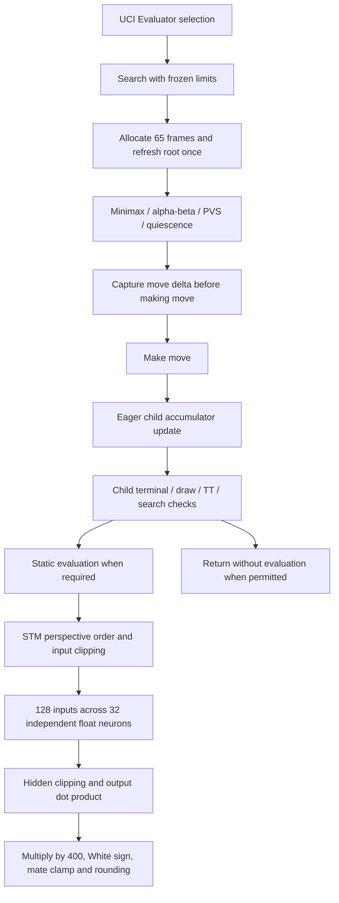

# StockBear NNUE 64/32 — Performance Profiling Report

Date: 17 October 2026. Workspace: `nnue-profiling-20261017/`.

## Executive summary

**The float inference head is the largest measured NNUE bottleneck.** A bounded native instruction-pointer sample attributes **52.90%** of execution to `nnue_side_to_move`, versus **12.74%** to identifiable accumulator maintenance. The head ranges from **43.94–61.34%** across the four sampled positions. These are approximate exclusive sampling shares, not hardware-counter measurements.

The kernel named `scalar` **already generates 256-bit vector float instructions**. The frozen tournament head and the symbolized profiling head have identical **2,750-byte machine code**. Adding an “AVX2” label or simply enabling AVX2 is therefore insufficient. The useful next experiment targets the head's input clipping, data-dependent control flow and existing vector loop, retaining the exact float operation order.

The compact incremental updater is working: **one full refresh per search**, approximately one update per node, and no full piece-feature reconstruction at every child. **15.64%** of updated frames are never evaluated directly, but only **2.65%** have no evaluated descendant. Treating all unused frames as removable would substantially overestimate lazy-update gains.

At 1,000 ms, the median **within-position** NNUE/classical wall-NPS ratio is **0.503** (position IQR **0.453–0.605**). This differs from dividing the two evaluators' cross-position median NPS, and from the historical tournament aggregate. It is a throughput observation, not an Elo result.

No production source, weights, search policy, executable, default evaluator, prior study or training data was changed. All **653 protected files** passed before/after SHA-256 checks. No tournaments, training, new quantization or sealed-test access occurred.

## Environment and reproducibility

| Item | Recorded condition |
|---|---|
| Laptop / CPU | Acer Nitro ANV15-51; Intel Core i5-13420H, 8 cores / 12 logical processors |
| Memory | 34,049,220,608 bytes, approximately 31.7 GiB usable |
| OS / build | Windows x64; Zig 0.13.0 bundled Clang 18.1.6, `x86_64-unknown-windows-gnu` |
| Flags | C++17, `-O2 -pthread -Wall -Wextra -ffp-contract=off`, compact update strategy 2; no LTO |
| SIMD | OS-enabled AVX2 and FMA; CPUID reports AVX-VNNI support |
| Search | One search thread; CPU0 affinity; 16 MiB hash; frozen production options |
| Power | AC online before and after; OEM **Acer** power scheme `f9309321-c95b-4680-9e08-173c4ed318f2` |
| NitroSense | **Quiet / Eco**, confirmed by the user; no settings changed |
| Frequency / temperature | Aggregate frequency snapshots 1,992 / 1,884 MHz; not search-core boost measurements. Temperature unavailable through accessible ACPI telemetry |
| Antivirus | Windows Defender and Bitdefender registered; no evidence establishing active scan interference |

CPU0 reports CPUID hybrid core type `0x40`. The probe reports that type on all 12 logical processors, so it does not establish a complete physical P/E-core map. Search affinity was fixed; the sampler ran on CPU2. FMA support does not imply FMA use: contraction remained disabled.

Although the saved command has no `-march` flag, this Zig installation's generated compiler command selects host CPU features. **The actual assembly, rather than an assumed generic target, establishes SIMD use.** `binary-inspection.json` verifies the preserved release head and move-delta bytes against the analyzed build. Other executable sections differ; the binaries are not claimed to be wholly identical.

**Environmental limitation:** the early 3-second process delta showed little non-benchmark load; the final check showed one ChatGPT process at **12.28% of total 12-processor CPU capacity**. Its onset is unknown. Power mode stayed untouched, but clocks and background work were not controlled continuously. Absolute NPS and small differences are exploratory under Quiet/Eco. Do not interpret a 2–5% difference as an established improvement.

## Frozen network and protection

Target: selected expanded-data **780 → dual 64 → 32 → 1**, approximately 54,209 parameters. Checkpoint: `StockBear_NNUE_training/scaling-experiment-20261016/artifacts/medium/best.pt`, selected epoch 45. Checkpoint SHA-256: `7d9ca27194e664f5f1d42fe8e4a5d4bac2f600a989405df9d91512555abb8264`.

Export SHA-256: `a08ce2c60280c8c6dffbbe2f653b6c481e8d5282be7bed203db8b72492b0a2d3`. Preserved tournament binary SHA-256: `ffd785d4e8eecacbf6822d98f4a7b6f43972ea89e20c45d0135227e745eab606`.

The release binary was copied into the workspace. Counter/timer builds use the same original source and model through the existing build tool. Component/symbol builds use an isolated source snapshot. Existing generated integer constants are retained by the unchanged build path; no new model/export or integer inference experiment was produced. A final manifest records local artifacts and text-normalized hashes. Binary/source copies, generated headers, PDB and compiler assembly remain locally under ignored `artifacts/`.

## Actual execution path

* `main.cpp` selects classical or NNUE through UCI. `Search::static_evaluation` counts evaluation requests; the NNUE branch calls `nnue_white_score` using the current frame. Classical alone uses the pawn cache.
* Features are 768 piece/color/square indices, four cleaned castling rights and eight legal-en-passant files. White/Black accumulators have fixed storage order. Root refresh adds active rows and biases to both unclipped float accumulators.
* `nnue_move_delta` derives removals/additions before making the move. Captures remove the captured row; en passant uses the actual captured square; promotions substitute the promoted piece; castling moves king and rook. Ordinary king moves are ordinary deltas: **this v2 model is not king-relative**, so they do not require full refreshes.
* After making the move, state extraction checks castling rights and legal EP availability. EP legality can require capture generation. Compact updates sort changed rows, preserve ascending-row float arithmetic order, copy 64 lanes per perspective and apply row additions/subtractions. Compact children retain state metadata rather than all piece indices.
* Children are updated eagerly, before child TT/terminal exits. Null moves update state features without a piece delta. Descendant materialization still needs ancestor deltas even when an ancestor never requests an evaluation.
* The head orders side-to-move perspective first; clips 128 inputs to `[0,1]`; accumulates 32 hidden neurons using contiguous transposed weights; clips hidden values; computes a sequential output sum and scales by 400. White score conversion preserves the mate-score boundary and rounding contract.
* TT entries cache search scores/bounds, not accumulator frames or a standalone NNUE-output cache. Quiescence avoids stand-pat evaluation while in check and evaluates at many other visited nodes. Its search paths dominate the update count.

There is no per-call head heap allocation. The 65-frame stack is allocated once per search. Each frame is **1,176 bytes**: 512 float-lane bytes, 512 optional integer-lane bytes and 152 metadata bytes; stack allocation **76,440 bytes**. Logical child copying averages **518.65 bytes**, not 1,176 bytes. The integer storage remains allocated but is not maintained during float inference.

## Reproducible search baseline

Twelve fixed legal fixtures cover opening/history, quiet middlegame, tactical positions, pawn/rook endgames, imbalance, castling, promotion and legal EP. Ordinary king movement and special transitions are also covered by the existing native transition oracle. All fixtures and production options are saved in `positions.json` and `config.json`; no dataset supplies these fixtures.

There are **360 warm searches**: 12 positions × 3 repeats × 5 budgets × 2 evaluators. Evaluator order rotates; each search gets a fresh TT and appropriate history. Both evaluators use the **same release executable**. Node limits reach exactly 200,000; fixed-depth requests reach depth 5. Fixed-node work is deterministic within an evaluator, but the two evaluators search different trees. Timed nodes include unfinished work; depth/PV represent the last completed iteration.

The table first takes each FEN's three-repeat median, then summarizes those 12 values. IQRs show **position variation**, not repeat confidence intervals. Wall NPS includes protocol/setup overhead; engine-reported NPS and per-FEN ranges are retained in raw JSON/CSV.

| Limit | Classical wall NPS, median [position IQR], M/s | NNUE wall NPS, median [position IQR], M/s | Median paired NPS ratio | Completed depth, classical / NNUE |
|---|---:|---:|---:|---:|
| Depth 5 | 0.935 [0.532–1.281] | 0.740 [0.467–1.022] | 0.840 | 5 / 5 |
| 200,000 nodes | 2.640 [2.218–3.226] | 1.501 [1.437–1.596] | 0.559 | 7.5 / 7 |
| 100 ms | 2.748 [2.216–3.809] | 1.525 [1.423–1.551] | 0.492 | 7.5 / 6 |
| 500 ms | 3.079 [2.410–4.211] | 1.625 [1.555–1.702] | 0.510 | 8.5 / 8 |
| 1,000 ms | 3.103 [2.680–4.220] | 1.786 [1.638–1.869] | 0.503 | 9.5 / 9 |

Depth-5 searches are often only milliseconds long; fixed startup and timer resolution substantially depress their NPS. They demonstrate behavior and reproducibility, not steady-state throughput.

| 1,000 ms fixture | Classical M/s | NNUE M/s | Paired ratio | Depth C / N |
|---|---:|---:|---:|---:|
| Opening | 2.641 | 1.558 | .590 | 10 / 9 |
| Quiet middlegame | 2.637 | 1.716 | .651 | 8 / 8 |
| Tactical | 2.373 | 1.218 | .513 | 8 / 7 |
| Pawn endgame | 5.651 | 2.579 | .456 | 13 / 12 |
| Piece endgame | 3.379 | 1.664 | .493 | 10 / 9 |
| Imbalance | 4.064 | 1.807 | .445 | 9 / 8 |
| Castling rights | 4.761 | 1.765 | .371 | 10 / 9 |
| Promotion | 4.001 | 1.902 | .475 | 12 / 11 |
| En passant | 4.689 | 1.981 | .422 | 11 / 10 |
| Pins | 2.803 | 1.820 | .649 | 8 / 8 |
| Attack complex | 2.694 | 1.533 | .569 | 8 / 7 |
| Opening with history | 2.828 | 1.858 | .657 | 9 / 9 |

Within-FEN three-repeat NPS coefficient of variation: median **1.77%** for fixed nodes, **2.85% / 2.66% / 1.73%** for 100/500/1,000 ms. Maxima are **7.98% / 13.10% / 11.59% / 5.98%**, respectively. These few repeats do not establish precise confidence bounds.

For fixed nodes, median evaluation calls/node are **0.830 classical / 0.898 NNUE**. Median nodes/completed-depth are **26,786 / 28,571**. At 1,000 ms the corresponding values are **0.822 / 0.866** and **338,070 / 203,748**. Nodes/depth is descriptive, not a branching-factor or strength measure; different evaluator decisions and pruning prevent a pure evaluator-cost interpretation of the NPS gap. `baseline-per-position.csv` also contains qnode fractions, actual evaluation counts and wall-minus-reported elapsed time.

### Cold process starts

Twenty-four additional 100-ms searches use four of the **same fixtures**, three repeats and a new process each time. “Cold” does not flush OS/file/CPU caches. Median engine startup is **43.0 ms classical / 44.5 ms NNUE**, excluded from search wall NPS. Search wall durations are approximately 103–104 ms.

On these matched fixtures, median cold/warm NPS ratios are **1.056 / 1.105**, with ranges **0.952–1.160 / 1.017–1.125**. Cold runs occurring later were sometimes faster; there is **no established cold-cache penalty** here. Temporal/environment variation and short budgets prevent attributing these differences to caches. Raw cold results must not be compared against the full 12-position warm median.

## Instrumentation and native profiling

Three builds × 12 fixtures × three repeats search exactly 200,000 nodes, giving **108 searches**. Move, score, depth, seldepth, PV and ordinary search counters match across release, counter and timer builds. The additional symbol build passes the same check on all 12 fixtures.

| Observer | Median elapsed multiplier vs release | Position IQR | Range |
|---|---:|---:|---:|
| Work counters | 1.103× | 1.080–1.132× | .937–1.181× |
| Exclusive clocks plus counters | 2.270× | 2.023–2.366× | 1.941–2.929× |

The counter build's faster outlier is measurement/environment noise, not an optimization. Clock overhead is large and disproportionately inflates tiny scopes. **Clock percentages below are not production time shares.**

WPR was installed, but starting its CPU profile failed with Windows policy error **`0xc5585011`**. WPA, VTune and Visual Studio CPU Profiler were not found in the inspected locations. No tools were installed. The existing Zig COFF linker rejected GNU map output; installed MinGW `nm` cannot read x64 PE. A matching local PDB and Windows DbgHelp provide symbols instead, with no symbol-server downloads.

The alternative bounded sampler records the active search thread's instruction pointer using Windows thread context APIs, always resuming suspended threads in `finally`. It touches only its own isolated child. Four positions × three repeats × sampled/unsampled 1,500-ms searches produced **4,074 samples**, **zero failed context reads**, and a median suspension/read interval of **40.1 μs**. Sampling intervals are randomly spaced 2–4 ms. Sampled/unsampled per-FEN median NPS ratios range **.971–1.006**. This is low enough for coarse hotspot ranking, not cycle-accurate profiling or a statistical confidence interval.

| Native attribution | Samples / share |
|---|---:|
| Float head, exclusive function | 2,155 / **52.90%** |
| Identifiable accumulator maintenance, including inlined descent and delta sorting | 519 / **12.74%** |
| Other search, move generation, ordering, runtime and unresolved work | 1,400 / **34.36%** |
| Dense-loop source line 493, subset of head | 1,113 / **27.32% of total** |
| Input-clamp source line 491, subset of head | 651 / **15.98% of total** |
| Hidden-clamp/output line 496, subset of head | 214 / **5.25% of total** |

Inlining limits attribution. The maintenance share includes recognizable NNUE functions/templates but excludes ambiguous generic sorting/runtime samples; it is not an exhaustive exact total. Source-line assignments are compiler debug locations, not isolated instruction timing. Ordered move sorting and SEE are visible secondary hotspots. Hardware cache/branch misses, retired instruction counts, utilization of execution ports and cycles were **not measured**.

### Exclusive clock component totals

These totals cover 36 NNUE searches, **7.2M nodes**, and **10,789.802 ms** of instrumented categorized time. Subscopes are exclusive: `nnue_update` below excludes its separately timed rows/copies/metadata. Averages include observer effects. The complete table is `component-clock-times.csv`.

| Component | Calls | Total ms | Average ns/call | Instrumented % | ns/node |
|---|---:|---:|---:|---:|---:|
| Head, combined activation/dense/output | 6,089,058 | 2,423.160 | 398.0 | 22.46 | 336.5 |
| Update bookkeeping, excluding subscopes | 7,192,359 | 1,523.580 | 211.8 | 14.12 | 211.6 |
| Changed-row arithmetic | 14,384,718 | 502.807 | 35.0 | 4.66 | 69.8 |
| Float accumulator copying | 14,384,718 | 408.924 | 28.4 | 3.79 | 56.8 |
| State metadata writes | 14,384,718 | 391.843 | 27.2 | 3.63 | 54.4 |
| Move-delta feature indexing | 7,169,589 | 200.559 | 28.0 | 1.86 | 27.9 |
| State extraction/perspective indexing | 7,192,359 | 199.778 | 27.8 | 1.85 | 27.7 |
| Full root feature extraction | 36 | .089 | 2,477.8 | <.01 | <.1 |
| Root refresh, exclusive of features | 36 | .054 | 1,497.2 | <.01 | <.1 |
| Score/evaluation wrapper | 6,089,058 | 376.920 | 61.9 | 3.49 | 52.3 |
| Ordering | 3,149,046 | 715.562 | 227.2 | 6.63 | 99.4 |
| Move generation | 8,215,497 | 497.634 | 60.6 | 4.61 | 69.1 |
| Other search | 36 scopes | 2,411.674 | — | 22.35 | 335.0 |

Allocation counters record **4,059 allocations / 3,268,848 requested bytes** across these 36 searches, around 113 / 90.8 KB per search. They start inside `Search::run`, **after TT construction**, so they do not represent all process allocations or include the 16 MiB TT. Stack allocation alone accounts for 2,751,840 bytes. Remaining allocations include search bookkeeping and containers; neither this counter nor source inspection identifies per-head heap allocation. The instrumented classical control records 2,714 allocations / 344,864 bytes across 24 searches, also excluding TT/pawn-cache construction.

The classical clock control spends 20.35% in its evaluation wrapper plus 20.41% in separately clocked pawn, attack, material/PST, king-safety and endgame terms. Its other-search share is 26.18%. Those differently nested scopes also have substantial overhead; they cannot establish a production classical-vs-NNUE time decomposition. Release NPS is the comparison authority.

## Batched component measurements

Seven passes × 12 fixtures × 100,000 calls, plus warmup. Values below are median [IQR] nanoseconds across the 84 position/pass samples, **including harness overhead**. Root/first-legal-child inputs repeat, giving unusually favorable branch/cache locality.

| Operation | ns, median [IQR] |
|---|---:|
| Harness only | 1.79 [1.76–1.82] |
| Move delta | 2.71 [2.67–2.81] |
| State extraction | 2.39 [1.78–2.53] |
| Actual compact search update, including state extraction | 45.67 [42.22–84.43] |
| Compact update with supplied states | 35.06 [29.43–72.95] |
| Lane-only copy, existing microbenchmark | 2.86 [2.61–3.04] |
| Full feature extraction, existing microbenchmark | 104.24 [30.23–148.95] |
| Full root refresh, existing microbenchmark | 241.07 [72.61–319.52] |
| Input activation materialized separately | 11.96 [11.53–13.71] |
| Dense stage with production-style fused input clipping | 110.66 [107.42–117.45] |
| Hidden clipping/output/scaling | 18.81 [17.61–20.74] |
| Final CP conversion | 4.20 [4.09–4.48] |
| Actual production head, independent measurement | 129.83 [125.45–137.19] |
| Classical evaluation, existing microbenchmark | 146.65 [83.13–161.35] |

Standalone activation overlaps dense-stage clipping and **must not be added** to it. Component function boundaries/stores differ from production, so even dense+output is a corroborating decomposition, not an exact additive search cost. Counts, total batched duration and distributions are reconstructible from raw records; these probes do not count operation frequency in a real search.

An initial dense harness wrote every row to caller-visible storage and measured approximately 250 ns. It was corrected to use the production-style local aligned buffer before copying results out. The initial raw results remain in `components-initial-harness.json` for audit and are excluded from final component summaries. This demonstrates why apparently equivalent microbenchmarks can mislead.

The preserved older benchmark's `move_update_ns` (**58.77 ns**) times the generic full-metadata API, not the actual compact search updater. Using it as production maintenance cost would be incorrect.

### Repeated roots substantially understate head cost

A further harness calls the **same production head**, without changing its code, over fixed-seed legal-walk fixtures. Frames are prepared before timing; there is no search or engine game.

| Rotating position count | Median head ns, seven passes |
|---|---:|
| 1 | 120.57 |
| 32 | 131.52 |
| 128 | 350.81 |
| 512 | 495.85 |

The 512 full frames occupy 602,112 bytes; different set sizes change both activation variability and memory locality. This **does not isolate branch prediction from cache effects**, but explains why a 130-ns repeated-root head cannot be extrapolated to all real search evaluations. Native source-line samples and data-dependent clamp branches make input transformation a promising target; a measured branch-miss rate is still unavailable.

## Accumulator efficiency and search interaction

Across the counter build's 36 fixed-node searches:

| Work | Count / ratio |
|---|---:|
| Nodes | 7,200,000 |
| Evaluation requests = actual NNUE head calls | 6,089,058; **.8457/node** |
| Quiescence nodes | 5,371,194; **74.60%** of nodes |
| Updates / copies | 7,192,359; **.99894/node** |
| Full refreshes | **36**, exactly one per root |
| Directly unevaluated updated frames | 1,124,859; **15.64%** |
| Updates with no evaluated descendant | 190,755; **2.65%** |
| Null-move updates | 22,770; directly unused 10,254 |
| Mean changed rows, one-perspective count | **2.326/update** |
| Mean pending edges to first evaluated frame | **2.462** |

Logical traffic estimates: **3.730 GB copied payload**, **8.564 GB changed-row weights**, **17.128 GB row-value reads/writes**. These count repeated logical accesses across both perspectives; they are **not measured DRAM traffic, memory bandwidth, or cache misses**. The head weights are contiguous/transposed, approximately 16 KiB; float transform rows total approximately 195 KiB. Hidden scratch storage is 64-byte aligned. No evidence demonstrates an alignment or full-refresh bottleneck.

About 15.67% of visits lack a direct evaluation, but evaluation calls can repeat on a visit, so this is distinct from subtracting head calls from nodes. TT, draw/terminal and checked-quiescence exits all contribute. The ordinary `cutoffs` counter describes TT cutoffs; reverse-futility and null cutoffs have their own counters. These event counts overlap search structure and are not additive “evaluations saved.” `instrumented.json` preserves them.

The current compact design is materially efficient, while still maintaining eager frames. Most directly unused frames have evaluated descendants; laziness still needs their ordered deltas. Pending edges are a logical model, not evidence of an implemented cancellation scheme. There is an inactive deferred-update prototype in source, but it was **not enabled or benchmarked** here. Skipping only leaf-unused updates at equal average cost would affect roughly **0.34% of whole time** using the identifiable-maintenance sampling share; that is a rough uniform-cost calculation, not a strict bound or a measured speedup.

## Instruction, memory and integer findings

Frozen float inference uses `vbroadcastss`, **YMM `vmulps`/`vaddps`**, four independent groups of eight hidden neurons, scalar input comparisons/branches, and a sequential output reduction. Accumulator rows also use YMM vector operations. FMA is absent under the saved flags. The head is therefore not a wholly scalar arithmetic implementation, even though its API name says `scalar`.

Clipping/loop control and floating add dependencies remain; the samples put 15.98% of total at input clipping and 27.32% at the dense-loop source location. Those locations overlap compiler scheduling and cannot by themselves identify a single limiting microarchitectural resource. Source/disassembly show inlining of update work into `descend_nnue`; optimized line/function attribution must account for this.

The previous scaling study measured **323.3 ns integer vs 117.8 ns float head** for 64/32, a **2.74×** slowdown. This is historical evidence from its own controlled hot-position test, not a newly repeated integer benchmark.

Inspection refines the explanation:

* Existing integer inputs/weights are **int16**, activations scaled to 4,096, accumulator/dense sums int32. This is not Stockfish-style compact byte inference.
* The compiled integer path **already autovectorizes with XMM `vpmaddwd`**. It is incorrect to blame the whole slowdown on an absence of SIMD. It repeatedly computes row-major dot products and horizontal reductions for each hidden neuron, unlike float's neuron-parallel transposed layout.
* Input clamp/rescale, hidden clamp/rescale, packing, reductions and output dequantization add work. Constant power-of-two divisions compile into shifts/rounding sequences; the inspected head does **not** contain general integer divide instructions. Conversion overhead exists, but expensive `idiv` is not the explanation.
* Quantized search falls back to generic full-metadata move updates, adding work independently of head inference. Bounds permit int32 accumulations but do not justify blindly narrowing them to int16.
* AVX2 signed-int16 dot operations and CPU AVX-VNNI create possible future paths. Byte-dot/VNNI layouts would require a separately validated precision/range contract; their speed and chess quality are **unmeasured**. Smaller storage does not guarantee fewer instructions or better whole-search NPS.

Optimized integer inference is worth a **later gated investigation**, after float-head work. It is not the first implementation and has no proven speed advantage or deployment approval. No new integer representation was created or executed in this phase.

## Stockfish reference comparison

Official upstream was read as a reference; no Stockfish code was copied. Observed upstream master revision: `5c4cef0bfe61fb3249178b2bcf21f5673557efe7`. Links identify the inspected techniques; upstream architecture and feature definitions differ from the frozen StockBear model.

| Technique | StockBear status and compatibility | Target, risks and validation |
|---|---|---|
| Incremental updates | Already compact and vectorized; full refresh once/root | About 13% recognizable maintenance. Any simplification must preserve row ordering, EP/rights, null history and sibling restoration; compare fixed-work PV/counters and NPS |
| Lazy stack materialization | Production eager; inactive prototype exists | Only 2.65% leaf-unused updates here. Ancestor deltas cannot simply be dropped. Test deep/sibling/null/PVS re-search paths; reject if bookkeeping exceeds savings |
| Accumulator refresh caching | No separate NNUE cache; v2 king-independent | Refresh cost negligible. King-indexed caches have little measured target here; avoid cache keys/invalidations without evidence |
| SIMD head / aligned layout | Float head already YMM; transposed weights and aligned scratch | Focus on clipping/control/layout, not ISA naming. Preserve per-neuron addition order and no-FMA policy; bitwise head and fixed-work search parity |
| Quantized packed inference | Existing int16/XMM experiment slower | Deferred; different scales/packing need overflow, score-error and future game validation before adoption |
| Sparse activation use | Dense head visits all 128 inputs; fixture median 75 zero inputs | Zero skipping could reduce arithmetic but adds indexing/branches and signed-zero/parity risks. Root sparsity is not a search-wide distribution; measure actual search before implementation |
| Avoid recomputation / reuse | Root incremental state already reused; TT avoids some evaluations | Output-cache or search-policy changes lack a measured target and add context risks. Preserve current TT/search semantics |

Upstream's stack defers materialization and uses refresh caches when required by its features; StockBear can borrow the design ideas, but its tiny king-independent transformer changes their value. [Official accumulator implementation](https://github.com/official-stockfish/Stockfish/blob/master/src/nnue/nnue_accumulator.cpp).

Upstream combines perspective transformation, vector activation handling and nonzero tracking with aligned weight storage. The mechanism is a reference for independently designed clipping/layout experiments, not permission to change StockBear's activation mathematics. [Official feature transformer](https://github.com/official-stockfish/Stockfish/blob/master/src/nnue/nnue_feature_transformer.h).

Architecture-specific affine/sparse layers and explicit ISA operations illustrate why packed integer design must be assessed as a complete pipeline. [Official architecture](https://github.com/official-stockfish/Stockfish/blob/master/src/nnue/nnue_architecture.h), [official SIMD helpers](https://github.com/official-stockfish/Stockfish/blob/master/src/nnue/simd.h).

## Ranked opportunities and Amdahl estimates

For sampled head fraction `f=.52896`, whole-workload speedup is `1 / ((1-f) + f/head_speedup)`, assuming unchanged search work and no new overhead.

| Hypothetical head speedup | Whole-search factor | Matched ratio .503 scaled by factor | Fraction of current NPS gap recovered |
|---|---:|---:|---:|
| 1.10× | 1.051× | .528 | 5% |
| 1.20× | 1.097× | .552 | 10% |
| 1.50× | 1.214× | .611 | 22% |
| 2.00× | 1.360× | .684 | 36% |

This combines the four-position sampling profile with a 12-position paired median as a **planning scenario**, not a position-wise forecast. Amdahl's impossible zero-cost-head ceiling is 2.123×; it is not attainable guidance. Equal NPS would require approximately **1.99× whole-engine throughput**, unsupported by an unimplemented optimization.

| Priority | Candidate | Measured affected area | Difficulty / correctness risk | Evidence-based decision |
|---|---|---|---|---|
| 1 | Float input clipping and head control/layout | 53% head; input source location 16% | Moderate; preserve float order, rounding, dispatch | First approve a reversible head-only prototype. A 1.2–1.5× head improvement would yield about 10–21% whole improvement; that component improvement is **not yet measured** |
| 2 | Accumulator metadata/row-loop specialization | Approximately 13% identifiable maintenance | Moderate; legal EP/rights, special moves, row-order hazards | Even halving this entire share gives only about 1.068× whole. Measure state/row cases separately before selecting an approach |
| 3 | Lazy materialization | Subset of maintenance; 2.65% leaf-unused | High; ancestor chains, re-search and null state | Low expected benefit from simple deferral on this suite; no credible large gain forecast |
| 4 | Sparse float activation work | Unknown search-wide zero density; 75/128 zeros at median fixture root | Moderate/high; irregular control and signed-zero behavior | Collect search activation histograms after approval before implementing; speedup unknown |
| 5 | Redesigned integer SIMD path | Same head/maintenance, but old path 2.74× slower | High; numerical contract and quality | Investigate only behind a correctness/performance gate after float work; gain unknown |
| 6 | Refresh cache, allocator or global alignment changes | Refresh <.01% instrumented; no per-head heap allocation | Added complexity without demonstrated target | Reject as first work; no meaningful gain estimate supported |

**Recoverable gap:** no optimization has been measured, so there is no defensible promised recovery. A useful conditional initial envelope is a **1.10–1.21× whole-search gain**, recovering roughly **10–22% of the matched NPS shortfall**, if head work actually improves 1.2–1.5×. Closing the entire gap is not supported. NPS improvement also does not directly establish Elo or tournament outcomes.

## Validation, artifacts and stopping point

* Preserved files: **653/653 unchanged**. The active engine and classical default remain intact.
* Transition oracle: **31,876 moves + 26,908 null transitions**, bitwise parity, including special-move and restoration cases.
* Counter/timer search parity: **36 matched triplets**; symbol-build parity: **12 matched fixed-node searches**.
* Split-head harness: **16,884 executed bitwise comparisons** across fixtures/passes and seeded finite accumulator patterns; this is not a count of unique random positions.
* Native samples: no context failures; all successful suspensions paired with resumption. WPR final status is inactive.
* No full application test suite or desktop GUI test was run: existing application code is unchanged. Verification concerns measurement integrity, frozen inference and protected artifacts.

Raw results: `baseline.json`, `instrumented.json`, `micro.json`, `components.json`, `varying-head.json`, `native-samples.json`, `native-symbols.json`, `classical-timers.json`. Summaries: `summary.json`, `baseline-per-position.csv`, `component-clock-times.csv`. Reproduction instructions and complete local artifact references are in the workspace README and manifest.

**Recommended first implementation, pending explicit approval:** add an optional float-head input-clipping/control-flow variant, preserving current weights, per-neuron arithmetic order and no-FMA semantics; measure it on varying-position heads and matched fixed-node searches. Keep the existing kernel as the fallback. Do not start with “turn on AVX2,” lazy accumulators or integer replacement. This profiling phase ends here; the next implementation stages are specified in `NNUE_OPTIMIZATION_ROADMAP.md`.
