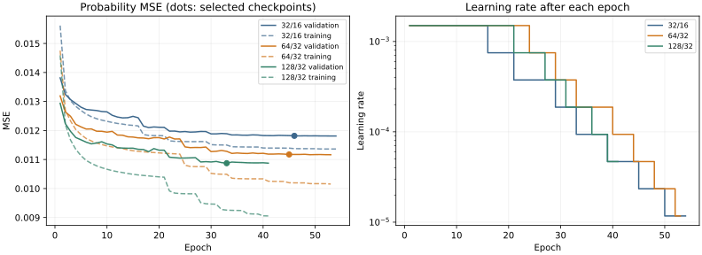

# StockBear NNUE Scaling Experiment Report

## Executive summary

The **128/32** model has the lowest selected-checkpoint validation blended MSE: **0.010872471**, a **7.99% reduction** versus the expanded 32/16 baseline. Its teacher-probability MSE improves **7.89%**. On isolated native microbenchmarks its float head costs **4.43×** and its move-derived accumulator update **1.33×** the baseline. These are measured evaluation costs, not whole-search slowdowns. No games were played and no Elo improvement is claimed.

The test split was never opened, hashed or evaluated by the experiment. Existing engine sources, active binaries, exported networks, old checkpoints and baseline history were preserved; see the preservation receipt.

## Architecture and data contract

All models share 780 dual-perspective features: 12 relative piece/color classes × 64 squares, four relative castling rights and eight legal-en-passant files. There are at most 37 active features per perspective, with padding index 780. A shared sparse embedding sum plus bias forms each unclipped accumulator. Training input orders side-to-move first; native state stores White then Black and reorders only in the head. Both activations clip to [0,1]; the linear output is centipawns/400.

| Architecture | Exact parameters | Float tensor bytes | Dense multiply-adds/evaluation | Float accumulator bytes |
|---|---:|---:|---:|---:|
| 32/16 | 26,081 | 104,324 | 1,040 | 256 |
| 64/32 | 54,209 | 216,836 | 4,128 | 512 |
| 128/32 | 108,353 | 433,412 | 8,224 | 1,024 |

Parameter counts come from `model.parameters()`, including the registered zero padding row. Formula: `782W + 2WH + 2H + 1`. The head arithmetic grows about 3.97×/7.91×; refresh/add-subtract work grows 2×/4× with accumulator width. Native frames also retain optional integer state and feature metadata, so their full allocation exceeds the float-only column.

## Training controls and reproducibility

The prepared v2 fingerprint is `99dc8cbe82f7fe529cbe219297891431e4c4fe4f65e601ca4ee504313aca8bdb`. Training uses 4,616,965 positions and validation uses the identical 573,685 positions for every model. The 578,136-position test split remains sealed. Only train/validation arrays and ordinal files are checksum-verified and memory-mapped. The prepared manifest is read as metadata.

All runs use seed 20261016, epoch shuffle `default_rng(seed + epoch)`, batch 2048, AdamW (fused CUDA), initial LR 0.0015, weight decay 0.05, gradient clipping 1.0, at most 60 epochs, patience 8, ReduceLROnPlateau patience 2/factor 0.5/minimum LR 1e-5, four CPU threads, float32 (no AMP), and deterministic algorithms with TF32 disabled. Target: `0.9 * sigmoid(clip(stm_cp,-2000,2000)/400) + 0.1 * stm_outcome`; loss is probability MSE.

Runtime: PyTorch 2.7.1+cu128, NumPy 2.2.6, NVIDIA GeForce RTX 4050 Laptop GPU. Each larger model passed a two-full-epoch pilot with falling training/validation loss, finite gradients and <1 GiB peak allocation. Pilots resumed into full runs without resetting optimizer, scheduler or RNG. No schedule adjustment was indicated by these health checks. This controls the experiment; it does not establish the optimal schedule for every architecture.

`stockbear.scaling_train` reuses the original model, batches, target and metrics. The legacy expanded trainer and model files are unchanged, preserving old resume signatures. New checkpoints store architecture, configuration, data/code/runtime identity and optimizer/scheduler/RNG state. Writes publish complete epochs atomically. Partial epochs replay on resume. `best.pt`, `raw_best.pt`, `last.pt` and `final.pt` have separate roles; no previous checkpoint was overwritten.

## Baseline checkpoint investigation

Expanded baseline training completed after **54 epochs**, stopping at eight epochs without a threshold-sized improvement. `best.pt` is **epoch 46**, MSE **0.011816098605106847**. The selection condition is strictly `value < selected_best - 0.00001`; the same threshold resets early-stopping patience. Epoch 53 achieved **0.01180995912419805**, only **0.000006139480908798** better, so it did not replace `best.pt`. This is the implemented threshold policy, not a corrupted metric or checkpoint.

Epoch-53 weights were not saved and cannot be recovered from the history. Of the available weights, `last.pt` at **epoch 54** is numerically best, MSE **0.011810467727504072**. The primary comparison uses epoch 46 to match the exact checkpoint rule across all models. Epoch 54 is included as a sensitivity check. The new runs also save literal minima separately, without changing the primary selection or patience policy. Neither baseline was retrained.

## Training and validation results

| Metric | 32/16 | 64/32 | 128/32 |
|---|---:|---:|---:|
| Parameters | 26,081 | 54,209 | 108,353 |
| Selected validation blended MSE | 0.011816099 | 0.011173891 | 0.010872471 |
| Teacher probability MSE | 0.009763357 | 0.009238826 | 0.008993366 |
| Clipped CP MAE | 129.607 | 124.932 | 122.524 |
| Clipped CP RMSE | 222.532 | 216.302 | 214.014 |
| Balanced CP MAE | 96.660 | 94.100 | 92.778 |
| Sign accuracy | 90.170% | 90.914% | 91.330% |
| Recorded epoch time total | 13.19 min | 10.29 min | 8.80 min |
| Epochs completed / selected | 54 / 46 | 53 / 45 | 41 / 33 |
| Raw minimum epoch / MSE | 53 / 0.011809959 | 53 / 0.011164259 | 33 / 0.010872471 |
| Selected-weight training MSE | 0.011362214 | 0.010160484 | 0.009121544 |
| Validation minus training MSE | 0.000453885 | 0.001013407 | 0.001750928 |
| Peak CUDA allocated | Not recorded | 75.98 MiB | 81.91 MiB |

Centipawn errors clip both predictions and teacher scores to ±2000. Balanced CP MAE uses positions with |raw teacher CP| ≤500; sign accuracy uses |raw teacher CP| ≥100 and a strict prediction >0. Teacher probability uses clipped teacher CP. All selected checkpoints were reloaded and their saved validation MSE reproduced within 1e-7. Training duration sums measured epoch times, including pilots and validation; it excludes startup, verification, checkpoint writes, pauses and this investigation. Background native compilation affected some training epochs, so duration is descriptive, not a controlled training-speed benchmark.

### Differences relative to the selected baseline

Entries are signed candidate-minus-baseline differences, followed by relative percent. Lower is better except sign accuracy; its absolute difference is shown in percentage points.

| Metric | 64/32 Δ (relative %) | 128/32 Δ (relative %) |
|---|---:|---:|
| blended_mse | -0.000642208 (-5.435%) | -0.000943627 (-7.986%) |
| teacher_probability_mse | -0.000524531 (-5.372%) | -0.000769991 (-7.887%) |
| clipped_cp_mae | -4.674 (-3.607%) | -7.083 (-5.465%) |
| clipped_cp_rmse | -6.230 (-2.800%) | -8.519 (-3.828%) |
| balanced_cp_mae | -2.560 (-2.648%) | -3.882 (-4.016%) |
| sign_accuracy_abs_cp_ge_100 | +0.7440 pp (+0.825%) | +1.1603 pp (+1.287%) |

### Phase analysis

Material/ply-based phase metadata is consistent across sources. The old-v1 validation subset (4,569 positions) had no stored phase and received the same rule at preparation. These labels are deterministic heuristics, not annotated phase ground truth. Metrics below are teacher-probability MSE / clipped CP MAE.

| Phase (positions) | 32/16 | 64/32 | 128/32 |
|---|---:|---:|---:|
| opening (48,252) | 0.0020471 / 46.75 | 0.0018788 / 44.57 | 0.0018001 / 43.20 |
| middlegame (365,942) | 0.0101021 / 129.41 | 0.0096408 / 125.73 | 0.0094072 / 123.47 |
| endgame (159,491) | 0.0113206 / 155.13 | 0.0105432 / 147.41 | 0.0102201 / 144.35 |

Teacher-MSE reductions by phase relative to 32/16: 64/32 opening +8.22%, middlegame +4.57%, endgame +6.87%; 128/32 opening +12.07%, middlegame +6.88%, endgame +9.72%.

### Generalization, uncertainty and diminishing returns

Selected-weight train/validation gaps above distinguish generalization from training fit; epoch training loss also averages weights changing throughout the epoch and should not be treated as the selected model's exact training score. The learning curves show plateaus and the effect of LR reductions. These are development-set results after repeated checkpoint selection, not unbiased test estimates.

- 64/32 teacher-MSE difference: -0.000524531; paired game-bootstrap 95% interval [-0.000564696, -0.000484760] over 44,155 validation game families (1,000 replicates).
- 128/32 teacher-MSE difference: -0.000769991; paired game-bootstrap 95% interval [-0.000814505, -0.000726975] over 44,155 validation game families (1,000 replicates).

The selected-weight validation-minus-training gaps are 32/16: 0.0004539, 64/32: 0.0010134, 128/32: 0.0017509. A wider gap shows additional capacity fitting training data more closely; lower selected validation error still demonstrates improved holdout teacher prediction for this seed. Late-epoch drift above the literal minimum is 32/16: 0.00000051, 64/32: 0.00000000, 128/32: 0.00000170. This quantifies late plateau/overfit rather than judging from training loss alone.



For 128/32, selected-weight training MSE falls 19.72% versus the baseline, while validation MSE falls 7.99%. The increasing gap indicates more overfitting even as validation prediction improves. The second capacity doubling yields a smaller relative validation gain than the first, indicating diminishing returns per parameter in this experiment.

These intervals resample matched game families; they do not include training-seed uncertainty, repeated model selection or source-distribution shift. Only one training seed was run per architecture. The 128/32-versus-64/32 blended-MSE change is a 2.70% reduction, for roughly twice the parameters and twice the dense head arithmetic. Do not infer an Elo return from this marginal teacher-fit gain.

### Baseline sensitivity and literal-minimum checkpoints

| Model / checkpoint | Epoch | Validation blended MSE |
|---|---:|---:|
| 32/16 / last.pt | 54 | 0.011810468 |
| 64/32 / last.pt | 53 | 0.011164259 |
| 64/32 / raw_best.pt | 53 | 0.011164259 |
| 128/32 / last.pt | 41 | 0.010874170 |
| 128/32 / raw_best.pt | 33 | 0.010872471 |

Against the numerically best available baseline weights (epoch 54), the selected candidate blended-MSE reductions are 64/32: 5.39%, 128/32: 7.94%. The primary comparison is therefore not dependent on treating the threshold-selected baseline as its literal minimum.

## Native inference compatibility and measured cost

The model file format and header generator already support width ≤256 and hidden ≤128. `nnue_dimensions.hpp` and the embedded `WIDTH`/`HIDDEN` constants determine compile-time accumulator and head sizes; there is no fixed 32/16 requirement. All three models compile through the unchanged native evaluator. Changing an embedded architecture requires rebuilding a binary, not changing the search algorithm. The legacy export CLI assumes legacy test artifacts and is unsuitable here; the isolated exporter derives/validates legacy dimensions and writes the same float32 format without any test access.

Native state keeps unclipped White/Black sums, copies parents into distinct child storage, and applies move deltas for ordinary moves, captures, promotions, castling and en passant; castling/EP state features are checked after the move. Roots refresh fully; null moves preserve piece sums and update state/perspective. For every architecture and kernel, the existing verification suite exercised 31,876 move transitions and 26,908 null moves, plus sibling/board restoration and clipping boundaries. Compact search updates matched the reference update bits. This verifies isolated accumulator behavior, not whole-search or UCI integration of new networks.

Benchmarks used unchanged production inference with isolated `nnue-bench` binaries, Zig C++17 `-O2`, `-ffp-contract=off`, default compact update strategy, on the i5-13420H. Twelve validation positions (four per phase), six repeats and 20,000 calls per operation/repeat were used, after 50,000 warmup calls. Final runs use one fixed logical CPU (affinity inherited by child processes), rotate architecture order and alternate float/integer order. Values are medians across 72 hot per-position samples. There was no concurrent training during final measurements. Frequency and hot-cache effects remain; this is not a search NPS benchmark.

| Float operation (ns) | 32/16 | 64/32 | 128/32 |
|---|---:|---:|---:|
| feature_ns | 89.2 | 74.0 | 76.4 |
| copy_ns | 1.7 | 2.5 | 18.7 |
| move_update_ns | 47.9 | 47.7 | 63.7 |
| refresh_ns | 157.6 | 149.8 | 289.2 |
| head_ns | 48.9 | 117.8 | 216.5 |

Move-update timings include state-feature handling and parent copying; the benchmark times the move-derived update, not a complete search node. The separately verified compact search path is not timed as a search workload. Full refresh is a root/fallback cost; it should not be charged at every node.

For a cost projection, if baseline head and move-update time fractions are `f_h` and `f_u`, a first approximation is `T_candidate/T_baseline = 1 + f_h*(head_ratio-1) + f_u*(update_ratio-1)`, holding the search tree and all other work fixed. These fractions must be measured in whole search; a changed evaluator also changes the tree. No numerical NPS projection is asserted here.

### Export parity and optional integer inference

| Architecture | Float max CP error | Quant max CP error | Quant head ns | Quant update ns | Native frame bytes |
|---|---:|---:|---:|---:|---:|
| 32/16 | 0.000198 | 1.642456 | 77.8 | 45.8 | 664 |
| 64/32 | 0.000244 | 1.738953 | 323.3 | 48.3 | 1,176 |
| 128/32 | 0.000183 | 1.869064 | 645.7 | 80.6 | 2,200 |

The current integer head is slower than float by 32/16: 1.59×, 64/32: 2.74×, 128/32: 2.98×. Retain float for the next native comparison; this integer implementation is not a speed win.

Parity used the same 128 seeded validation FENs, including both sides to move; float tolerance 0.01 CP and experimental quantized tolerance 5 CP. The integer representation is derived separately with overflow bounds. Passing this small parity set does not establish full-distribution quantization quality or safe deployment.

The current `auto` kernel resolves to the scalar float implementation. Its transposed head exposes independent neurons to compiler vectorization, but AVX2 availability does not mean a dedicated AVX2 kernel is selected. Widths 64/128 and hidden 32 suit SIMD lanes. Explicit SIMD and quantization could reduce bandwidth/arithmetic, but must preserve accumulation order/parity or document numerical changes; optional integer timings above are measurements, not guaranteed improvements. Search-level cache pressure, frame copying and evaluation frequency still determine the actual equal-time trade-off.

## Recommendation and next stage

Advance **128/32** as the best teacher-prediction candidate, retaining **64/32** and **32/16** as cost/quality controls. Its validation gain justifies isolated native search-strength testing, not replacement of the active evaluator. Compare unchanged-search binaries under equal time with paired openings, and measure total NPS, completed depth, evaluation/update frequency and memory traffic alongside game scores. Retain classical as default.

Do not train 256/32 in this experiment. First determine whether the observed 128/32-versus-64/32 improvement survives a second training seed and whether its extra native cost is repaid in equal-time games. A larger model would double accumulator width/head arithmetic again; teacher MSE alone is insufficient justification for that expense.

## Checkpoints, outputs and reproduction

All new outputs are beneath `Z:\Code\Chess\StockBear_NNUE_training\scaling-experiment-20261016\`. Only this explicitly requested report is written at the repository root. Checkpoints are local, ignored research artifacts; code/configuration/results/identities are versioned. Absolute selected-checkpoint paths:

- **32/16 selected:** `Z:\Code\Chess\StockBear_NNUE_training\runs\expanded-20261016\v2\best.pt` (epoch 46, SHA-256 `c96f23042cd62de9262a0a658e954a838397d97104cfc9820eeca2c37fff0840`).
- **64/32 selected:** `Z:\Code\Chess\StockBear_NNUE_training\scaling-experiment-20261016\artifacts\medium\best.pt` (epoch 45, SHA-256 `7d9ca27194e664f5f1d42fe8e4a5d4bac2f600a989405df9d91512555abb8264`).
- **64/32 raw_best.pt:** `Z:\Code\Chess\StockBear_NNUE_training\scaling-experiment-20261016\artifacts\medium\raw_best.pt`.
- **64/32 last.pt:** `Z:\Code\Chess\StockBear_NNUE_training\scaling-experiment-20261016\artifacts\medium\last.pt`.
- **64/32 final.pt:** `Z:\Code\Chess\StockBear_NNUE_training\scaling-experiment-20261016\artifacts\medium\final.pt`.
- **64/32 history.json:** `Z:\Code\Chess\StockBear_NNUE_training\scaling-experiment-20261016\artifacts\medium\history.json`.
- **64/32 training.json:** `Z:\Code\Chess\StockBear_NNUE_training\scaling-experiment-20261016\artifacts\medium\training.json`.
- **128/32 selected:** `Z:\Code\Chess\StockBear_NNUE_training\scaling-experiment-20261016\artifacts\large\best.pt` (epoch 33, SHA-256 `86abe91a4a70831228b068b699435f2d8b496d4ff955be0878b4835943975e6e`).
- **128/32 raw_best.pt:** `Z:\Code\Chess\StockBear_NNUE_training\scaling-experiment-20261016\artifacts\large\raw_best.pt`.
- **128/32 last.pt:** `Z:\Code\Chess\StockBear_NNUE_training\scaling-experiment-20261016\artifacts\large\last.pt`.
- **128/32 final.pt:** `Z:\Code\Chess\StockBear_NNUE_training\scaling-experiment-20261016\artifacts\large\final.pt`.
- **128/32 history.json:** `Z:\Code\Chess\StockBear_NNUE_training\scaling-experiment-20261016\artifacts\large\history.json`.
- **128/32 training.json:** `Z:\Code\Chess\StockBear_NNUE_training\scaling-experiment-20261016\artifacts\large\training.json`.

Full epoch metrics, paired uncertainty and auxiliary checkpoint results are in `comparison.json`; native samples, build flags and source hashes are in `native-benchmark.json`. `validation-goldens.json` records validation-only benchmark provenance. `baseline-audit.json`, `pilot-health.json`, `phase-provenance.json` and `preservation-after.json` retain the investigation evidence. `artifact-manifest.json` identifies all checkpoints, native outputs and normalized experiment sources. Native exports/binaries and logs are under `artifacts/native/{baseline,medium,large}/`. The export `payload_sha256` and full file hashes are recorded. No tournament or label-generation process was launched.

From the training root in PowerShell:

```powershell
Set-Location Z:\Code\Chess\StockBear_NNUE_training
.\.venv\Scripts\python.exe -m stockbear.scaling_train check --config scaling-experiment-20261016/medium.json
# Fresh reproduction requires a new artifacts run path in a copied configuration.
.\.venv\Scripts\python.exe -m stockbear.scaling_train train --config scaling-experiment-20261016/medium.json --resume
.\.venv\Scripts\python.exe -m stockbear.scaling_train train --config scaling-experiment-20261016/large.json --resume
.\.venv\Scripts\python.exe -m stockbear.scaling_analysis compare
.\.venv\Scripts\python.exe -m stockbear.scaling_analysis native
.\.venv\Scripts\python.exe -m stockbear.scaling_report
```

A completed-run resume validates identity and restores the final state without additional epochs. Do not alter dimensions, hyperparameters or signed training sources in a resumable run. The native benchmark command overwrites only its own generated benchmark binaries/reports; different existing export bytes are refused. Old dataset preparation/training entry points remain available.

Validation: 15 focused tests passed (three architectures, legacy/new load, shape/count rejection, mmap checksum/test isolation, exact CPU resume equivalence, metric definitions and isolated native-format export). Full native transition, null, compact-update and validation-FEN parity checks passed for every measured model/kernel. No desktop game check was needed because the application and active engine were not changed.
