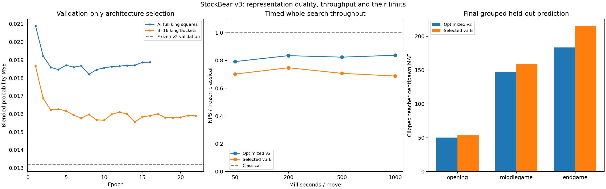

# StockBear NNUE v3 — King-Relative Research Report

## Executive summary

V3 is implemented and verified, but is not established as an improvement over optimized v2. Optimized v2 remains the preferred NNUE. Classical remains the default; no v2 weights or implementation are replaced.

Validation selected **B: 16 king buckets, shared 32/16 float32 network**, 329,185 parameters. Full 64-square candidate A overfit more severely. Both models, checkpoints and exact training sources are retained. Final held-out blended MSE is **0.015864 v3 versus 0.012978 v2**; clipped teacher MAE is **160.22 versus 143.93cp**. Prediction quality did not improve.

The user amended playing validation before play to **20 games at 500ms/move**, ten reversed-color opening pairs, including the smoke pair. V3 vs v2: **3 wins, 8 draws, 9 losses, 0 unfinished**, completed-game score **35.0%**. This is a small exploratory match; uncertainty and the conditional classical gate appear below.

Verification: **1159 passed in 114.32s (0:01:54)**; training package **40 passed**. Release preserved 240 classical/v2 searches exactly; UBSan preserved 96. All 48 v3 deterministic repeat/full-refresh cases matched. Native parity covers the complete 20,152-position grouped holdout.

## Architecture and native implementation

Feature contract A conditions every non-king piece-square feature on the own king's oriented square: 64×10×64 = 40,960 sparse piece inputs. B maps the oriented king to a 2×2-square region, `(rank//2)*4 + file//2`, giving 16×10×64 = 10,240. Both append 12 independent v2-style castling/legal-EP inputs; totals are 40,972 and 10,252. Empty squares and kings are not ordinary piece rows. Friendly/enemy colors normalize per perspective; Black mirrors ranks with `square^56`. Active indices sort ascending. Head order carries side to move.

At most 35 active indices per perspective are stored as uint16; training uses indexed EmbeddingBag sums, never dense input vectors. Both perspectives share a float32 32-wide table and bias. Their clipped [0,1] concatenation feeds a clipped 16-wide hidden layer and scalar side-to-move cp/400 output. No transfer learning, quantization, precision change, handcrafted blend, TF32 or fast-math was used.

| Candidate | King contexts | Parameters including padding | Model file bytes | Best validation MSE |
| --- | ---: | ---: | ---: | ---: |
| A full | 64 | 1,312,225 | 5,248,972 | 0.018203 |
| B bucketed | 16 | 329,185 | 1,316,812 | 0.015550 |

The independent `nnue_v3.hpp/.cpp` path loads a versioned 72-byte header plus fixed-order float payload. Architecture/layout ID 6 fixes the six-tensor 32/16 clipped head; feature IDs 1/2 distinguish full/bucketed inputs. SHA256, exact size, dimensions, finite/range bounds and zero padding are checked before activation. Failed loading retains the old model and selection. Details: [format](docs/nnue-v3/MODEL_FORMAT.md) and [design](NNUE_V3_DESIGN.md).

Each native frame is **308 bytes**, or **20,020 bytes** for 65 search frames, plus one immutable shared model and a 4KB transposed head. Accumulators stay unclipped in fixed White/Black order. Capture move deltas before make; update ordinary pieces/state rows without full sorted piece-list metadata. Refresh only the perspective whose king context changes; within-bucket king moves retain sums but still update rights/EP. Castling also moves the rook; null moves alter legal EP/head order. Roots refresh and child storage remains private. No lazy redesign was introduced.

UCI adds `Evaluator=nnue_v3` and `NNUEV3File`; `classical` remains default and `nnue` retains the chosen executable's embedded network. The v3 release build explicitly embeds frozen optimized Compact v2. The ordinary app executable retains its original embedded v1 model while gaining v3 support; use the study release for the exact three-way v2/v3/classical comparison. GUI selection cycles all three choices, marks v3 experimental and performs validation/UCI work off the GUI thread. No search/pruning/order/TT/time policy was changed.

## Dataset and training

Reused the existing 1.25M nominal labeled pool: **999,464 train / 19,930 validation / 20,152 test** examples. The smaller common holdout prefix is preserved exactly. V2 sparse rows losslessly provide king, piece and state information for v3 re-encoding. Each variant independently matched 12,288 parsed source FENs. Target and ordinal files are byte-identical, game groups are disjoint, original arrays retain their frozen hashes, and no Stockfish labels were regenerated.

Teacher profile `ddc2b43b123677466a9a9f8478f67ffc028a6582266a73e36a3272bc85b30f92` uses the existing 16,384-node Stockfish teacher labels. Targets remain 90% sigmoid(clipped teacher cp/400) plus 10% side-to-move game outcome. Original grouping/deduplication is inherited rather than resampled. New caches, checkpoints and reports live under versioned v3 directories on the project drive.

Fresh seed 20261016; float32 AdamW, learning rate .0015, decay .05, batch 2048, gradient clipping 1.0, validation plateau scheduler (patience 2, factor .5), early-stop patience 8, min-delta 1e-5, maximum 60 epochs. No incompatible v2 weights were loaded. CPU/native feature and forward gates preceded 20K-example, three-epoch GPU pilots. Only after finite gradients and safe resource measurements did full training start. One bounded fallback B was justified by A's validation overfitting; no larger model or hyperparameter sweep followed.

| Candidate | Epochs / best epoch | Train MSE at selected checkpoint | Validation MSE | Peak allocated CUDA MiB | Recorded epoch seconds |
| --- | ---: | ---: | ---: | ---: | ---: |
| A | 16 / 8 | 0.008349 | 0.018203 | 690.1 | 27.22 |
| B | 22 / 14 | 0.009540 | 0.015550 | 664.9 | 38.51 |

CUDA allocated memory excludes driver/context and allocator reservation. Both full runs fit comfortably within the RTX 4050's 6GB. GPU resident sparse indices dominate memory; no dense 40K input batches were created. Recorded epoch times include validation but exclude checkpoint I/O and data preparation; they are not isolated hardware throughput. Native compilation overlapped part of candidate B's training, so training duration is descriptive, not a controlled speed comparison. No tournament ran during training.

Checkpoint selection used validation only, before the single final test evaluation. Checkpoints retain optimizer/scheduler/RNG states; reports record strict dataset/config/runtime/source signatures. Exact pre-hardening A/B training sources are preserved alongside reports. Subsequent model-validator hardening changes no trained bytes. Source snapshots and runtime must match for exact resume; changed signatures are rejected.

## Held-out quality and calibration

| Metric | Optimized v2 | Selected v3 B |
| --- | ---: | ---: |
| Blended probability MSE | 0.012978 | 0.015864 |
| Teacher probability MSE | 0.011022 | 0.013801 |
| Teacher probability MAE | 0.071199 | 0.080150 |
| Clipped cp MAE | 143.927778 | 160.223247 |
| Clipped cp RMSE | 239.880299 | 260.050955 |
| Outcome Brier score | 0.145645 | 0.149505 |

[Held-out metrics](StockBear_NNUE_training/reports/v3/heldout.json) include calibration bins, phase, tactical/quiet heuristics and year breakdowns. [Additional strata](docs/nnue-v3/heldout-strata.json) cover pawn/rook endgames, material imbalance, king pressure, unusual promoted configurations, passers and drawish teacher scores. These overlapping heuristic labels are descriptions, not verified tactical classifications. Test data was not used for retuning. No additional candidate was selected from these test results.

## Native correctness and preservation

- Complete grouped heldout: 20,152 exact cross-language feature lists; maximum native/PyTorch difference **0.000366328cp**. GPU-training versus CPU reference maximum **0.000183105cp**. The allowed tolerance is 0.02cp, not integer-score equality.
- Selected B transition oracle: **91,629** real/sibling transitions, **21,542** nulls and **33,119** affected-context refreshes. Maximum refreshed/incremental lane error 9.53674e-07; output error 0.000732422cp. Ordinary moves, castling, EP/pinned EP, promotions, long walks, siblings and board restoration are included.
- Both feature variants passed independent native prototypes. Trained A is retained and independently verified. Sixteen extreme/clipping-boundary head cases passed; eight malformed-model classes were rejected by Python and native readers, including checksum-valid nonfinite and unsafe-magnitude payloads.
- Release: 24 FENs × two preserved evaluators × depths 4/6 and 100k/400k/1M nodes = **240 exact classical/v2 cases**, including moves, scores, PVs, visits, selective depths and counters. UBSan repeats **96** preserved cases. All **48** v3 fixed-work cases repeated exactly and matched full-refresh trees. Twelve cancellations and five terminal/draw-history cases pass per checked build. No v3-v2 tree equality is required or claimed.
- The full regression suite and training-package suite pass. V2 native evaluator/header, model, classical evaluation/constants, search-policy and TT headers remain byte-identical to the frozen baseline. Shared search changes only dispatch/state ownership; new UCI choices intentionally extend the protocol. [Release evidence](docs/nnue-v3/release-search-parity.json), [UBSan evidence](docs/nnue-v3/ubsan-search-parity.json).
- The ordinary app executable also preserves its original embedded model, classical default and all 32 checked classical/NNUE searches against its saved pre-v3 binary. [Application runtime evidence](docs/nnue-v3/application-runtime.json).
- UBSan native feature/transition/head/model checks passed without a detected error. AddressSanitizer remains unavailable with the pinned Windows toolchain, whose duplicate libc++ ABI symbols/missing MinGW runtime were independently diagnosed in the prior throughput phase; no new ASan pass is claimed. [Toolchain evidence](docs/nnue-v2-throughput/asan-probes.json).
- Automated GUI checks exercise all five time presets, comparisons and stale replies; the minimum frame was inspected. A real Windows SDL launch completed with a validated v3 move and a visibly correct frame. These are app-rendered frame checks, not manual interaction or OS screenshots. [GUI evidence](docs/nnue-v3/gui/gui-verification.json), [native frame](docs/nnue-v3/gui-native.png).

## Whole-search throughput and profiling

Zig 0.13, C++17, -O2 -ffp-contract=off; no LTO or fast-math. Intel i5-13420H, Windows, Python 3.11.8. Three rotated serial trials across 24 frozen FENs, Hash16, one worker, fresh search tables. Models have different trees; NPS ratios combine evaluation cost and evaluator-dependent search work. They are not pure implementation speedups. Time, nodes, completed depth, CPU accounting and iteration stability remain in raw records.

| Limit | Eligible FENs | V2/classical NPS | V3/classical NPS | V3/v2 NPS | Selected-FEN interval | V3−v2 mean depth |
| --- | ---: | ---: | ---: | ---: | --- | ---: |
| 100,000 nodes | 22 | 0.784 | 0.715 | 0.913 | [0.848, 0.984] | +0.045 |
| 400,000 nodes | 22 | 0.828 | 0.723 | 0.872 | [0.828, 0.920] | +0.000 |
| 1,000,000 nodes | 22 | 0.848 | 0.715 | 0.843 | [0.808, 0.880] | -0.045 |
| 50 ms | 22 | 0.792 | 0.702 | 0.886 | [0.818, 0.959] | -0.182 |
| 200 ms | 22 | 0.835 | 0.748 | 0.896 | [0.844, 0.953] | -0.045 |
| 500 ms | 22 | 0.824 | 0.707 | 0.858 | [0.825, 0.894] | -0.136 |
| 1,000 ms | 22 | 0.838 | 0.688 | 0.821 | [0.779, 0.865] | -0.045 |

Absolute NPS below is the geometric mean of per-position three-trial median engine NPS over the same eligible FENs (millions of nodes/second). It uses the engine's search timer, while the raw records also retain host wall time.

| Limit | Classical MNPS | V2 MNPS | V3 MNPS |
| --- | ---: | ---: | ---: |
| 100,000 nodes | 2.378 | 1.863 | 1.701 |
| 400,000 nodes | 2.438 | 2.019 | 1.762 |
| 1,000,000 nodes | 2.448 | 2.076 | 1.749 |
| 50 ms | 2.314 | 1.832 | 1.624 |
| 200 ms | 2.421 | 2.020 | 1.809 |
| 500 ms | 2.455 | 2.022 | 1.736 |
| 1,000 ms | 2.589 | 2.169 | 1.781 |

A separate serial 500ms initial-position search sampled whole-process memory every 10ms. These one-run measurements include the complete engine, embedded weights and Hash16; they do not isolate model allocation or establish a memory distribution.

| Evaluator | Sampled maximum working set MiB | Sampled maximum private MiB |
| --- | ---: | ---: |
| classical | 17.65 | 14.24 |
| v2 | 17.71 | 14.20 |
| v3 | 18.88 | 15.43 |

[Memory measurements](docs/nnue-v3/memory.json) were collected after the tournament, separately from release timing trials.

Aggregate ratios are geometric means of per-position trial medians. Bootstrap intervals resample selected FENs, describing suite sensitivity, not general-population certainty. Mate fixtures, mate-scored/early terminations and sub-10ms runs are excluded only from common aggregate ratios; all raw searches remain saved. Per-position ratios, eligible flags and min/median/max distributions are in [JSON](docs/nnue-v3/benchmark-summary.json) and [CSV](docs/nnue-v3/benchmark-summary.csv). CPU percentages use one logical core as 100%; wall includes UCI/fresh-TT setup. Affinity/frequency were not locked.

Intrusive clocks on the 24-FEN 400k-node v3 workload preserve every release tree. Largest exclusive scopes:

| Scope | Instrumented seconds | Calls |
| --- | ---: | ---: |
| search_other | 2.9716 | 24 |
| nnue_head | 1.9289 | 7,618,692 |
| nnue_update | 1.4140 | 9,596,361 |
| ordering | 1.0294 | 4,087,765 |
| movegen | 0.7922 | 10,982,637 |
| evaluation_other | 0.6095 | 7,618,692 |
| make | 0.4529 | 9,596,361 |
| table | 0.4168 | 3,646,962 |
| nnue_features | 0.4108 | 9,596,385 |
| nnue_refresh | 0.2358 | 1,587,988 |

Refresh scopes include root and king-bucket refreshes; state extraction is separately scoped, while copy, row application and index bookkeeping remain combined under update. Delta construction outside those scopes falls in search bookkeeping. These instrumented timings cannot isolate physical cache misses, copy latency or instruction costs and are not production runtime percentages. Hardware cache/branch counters were not collected. The larger weight table and refreshes are plausible overheads, not proven causal allocations. No aggressive SIMD, quantization, lazy or search-policy optimization was adopted for a model that already trails v2 prediction quality. [Raw profile](docs/nnue-v3/profile.json).

## Equal-node move-quality diagnosis

The comparison uses 100k candidate nodes and separate 65,536-node Stockfish root/child reference searches on 24 frozen examples plus 24 new outcome-blind legal-walk FENs absent from the source pool. All candidates have identical search settings. Child scores are mapped to the root mover; negative raw root/child deltas are retained and CPL is clipped at zero. Mates remain separate. Terminal children can report zero nodes/depth because no further search is required; these are explicitly flagged. Stockfish also supplied training labels, so this reference is not an independent measure of playing strength.

| Cohort | Evaluator | Root best-move agreement | Mean finite CPL | Negative raw deltas |
| --- | --- | ---: | ---: | ---: |
| all | classical | 28/48 | 25.93 | 15 |
| all | v2 | 33/48 | 31.29 | 14 |
| all | v3 | 29/48 | 34.07 | 11 |
| frozen | classical | 16/24 | 15.18 | 8 |
| frozen | v2 | 18/24 | 11.18 | 6 |
| frozen | v3 | 14/24 | 20.32 | 5 |
| fresh | classical | 12/24 | 38.37 | 7 |
| fresh | v2 | 15/24 | 54.58 | 8 |
| fresh | v3 | 15/24 | 50.00 | 6 |

Raw records retain tactical/positional/endgame examples, move disagreements, mate cases and a reference-CPL≥150 heuristic miss count. [Category diagnostics](docs/nnue-v3/quality-by-category.json) list disagreements and mate-confirmation flags by category; a finite-budget failure to confirm a reference mate is not proof of a lost forced mate. This small fixed suite cannot establish population move quality. [Quality evidence](docs/nnue-v3/quality.json).

## Bounded playing strength

**V3 vs v2:** 3–8–9 W–D–L, 0 unfinished, completed-game score 35.0%. Ten opening pairs; paired 95% bootstrap/censoring envelope **25.0%–45.0%**. Conditional Elo point estimate -107.5, exploratory only. Unknown-outcome score bounds 35.0%–35.0%.

The conservative bounded-pair Hoeffding 95% interval is **0.0%–77.9%** under nominal independent-pair assumptions. With only ten related opening pairs, the empirical bootstrap can understate uncertainty; its exclusion of 50% is not taken as a reliable general Elo finding.

Played-position aggregate NPS: v3 2.133M, opponent 2.782M; mean completed depths 8.19/8.23. These are different positions and trees; use fixed-FEN results for the cleaner throughput comparison.

The separately planned classical cohort was **not run**, because the predeclared ≥50% completed-game v3-v2 promise gate was not met. No extra tournament games were added to seek a favorable result. V3-versus-classical strength therefore remains unmeasured in this study.

Both colors use the same fixed neutral openings and 500ms/move settings. The smoke pair is part of the 20, not extra. Claimable draws are allowed; a 240 searched-ply cap is unfinished, never an adjudicated draw. Independent replay checks every move, result, pair/color and executable/external-model checksum. Only ten pairs, related openings and reused cohorts limit inference; no statistically reliable universal Elo conclusion is claimed.

The prior v2/classical result remains **11 wins, 14 draws, 15 losses / 40 games (45%)**. These new cohorts use only its first ten opening pairs. Any reused-opening comparison must select the matching first 20 old games, not directly contrast the full 40-game control with a 20-game sample as matched observations. Original raw cohorts are preserved in `baseline10.*` and `baseline30.*`.

The matching historical 20-game control subset is **5–8–7** for v2, score 45.0%. [Subset analysis](docs/nnue-v3/historical-matched-control.json) keeps those pairs together; different historical machine conditions and reused openings prevent treating it as independent confirmation.

## Conclusions and next steps

1. **Teacher prediction:** king conditioning did not improve the held-out metrics under this bounded data/training setup. Bucketing improved A's generalization but did not catch v2.
2. **Decision quality:** the equal-node reference and paired games provide limited direct evidence; neither model age nor lower training loss establishes superiority.
3. **Throughput cost:** measured release NPS, context refresh work and memory cost are tabulated above. Different trees and intrusive timers prevent assigning the entire difference to one evaluator operation.
4. **Equal-time objective:** use the recorded match uncertainty rather than the Elo point estimate. This experiment does not justify replacing the frozen v2 evaluator or changing classical defaults.
5. **Further research:** additional regularization, smaller/better-conditioned representations or more diverse grouped data may be worth a separately planned experiment. This phase does not start another architecture sweep, relabeling campaign or confirmation tournament.

## Identity and reproduction

| Artifact | SHA256 |
| --- | --- |
| Optimized v2 model | `788b865a15dbdeeb3e03b7493f8155fd19d6c73b9b0873453ad16fba51a65aa7` |
| V3 A | `08fb7a2a54c783566ed11dba3608459800d290a0cef2c38375202ef43a5f1803` |
| V3 B / selected alias | `610e67ddf3e1e556f9209c4ba9de879d780f3a018924e4d16edf93e997251b78` |
| V3 release executable | `c7b204ac751f71d98d49470b556d9af519de0508ca5d2a6fb6006db27fbd3a51` |

[Protocol and commands](docs/nnue-v3/README.md) · [Model selection](StockBear_NNUE_training/reports/v3/selection.json) · [Raw benchmarks](docs/nnue-v3/benchmark.json) · [Match summary](docs/nnue-v3/match-summary.json) · [V3-v2 PGN](docs/nnue-v3/match-v3-v2.pgn) · [Native holdout parity](docs/nnue-v3/heldout-native-parity.json) · [Final audit](docs/nnue-v3/final-audit.json) · [Manifest](docs/nnue-v3/manifest.json).

Native executables, build sidecars, compiler logs, source snapshots, checkpoints and preserved malformed-model probes remain local under the versioned artifact/training directories. Committed raw evidence, model files, source snapshots, build identities and generated figures support review. Original research and datasets remain intact.
