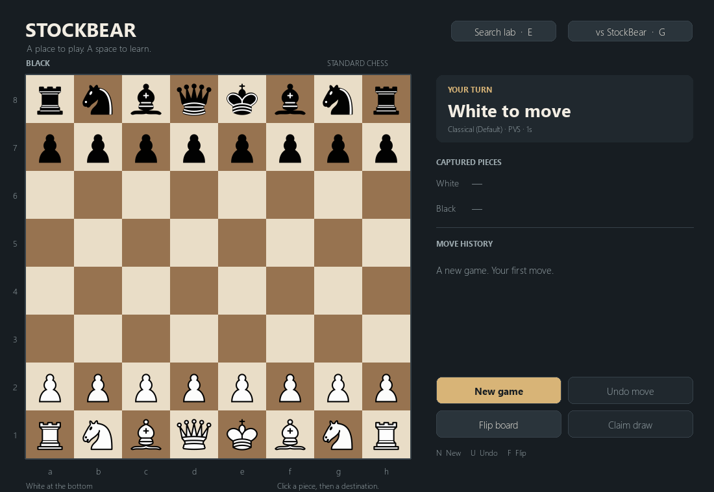
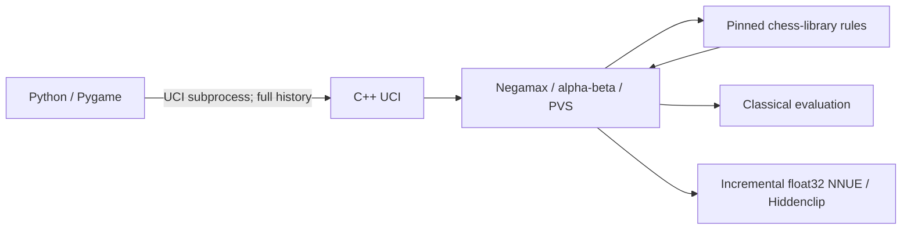

# StockBear

StockBear is a personal chess-engine project with a C++17 UCI engine, a Python/Pygame desktop game, handcrafted evaluation and an optional custom-trained NNUE. It began as ChessLab, an interface for studying search, and grew through search development, neural training, inference optimization and paired playing-strength tests.

**Final configuration: Classical by default; NNUE Hiddenclip is selectable.** The Grand Final was statistically inconclusive. Hiddenclip scored slightly more points, but did not establish the convincing improvement required to replace the preserved classical baseline.



## Features

- Legal chess with castling, en passant, underpromotion, checkmate, stalemate, repetition, fifty-move claims and insufficient-material handling.
- Local two-player play or a custom engine opponent; undo, board rotation, promotion selection, move history and draw claims.
- Negamax/Minimax, alpha-beta, iterative deepening, Principal Variation Search and quiescence with legal check evasions.
- Zobrist transposition tables with bounds, mate-distance normalization and draw/history context; completed-iteration fallbacks and cancellation.
- TT/PV ordering, promotions, SEE-ranked captures, private history/killers, aspiration retries, conservative null-move pruning, verified LMR, futility guards and budgeted check extensions.
- Tapered material/PST evaluation, pawn structure and passers, mobility, king safety, bishop pairs, rook activity, outposts, space, endgame activity and a fully keyed pawn cache.
- Incremental float32 NNUE with fixed White/Black accumulators, root refresh and isolated child states. Hiddenclip uses AVX2 clipping where available and a portable scalar fallback.
- UCI, time/depth/node limits, perft and evaluation diagnostics. Search runs off the UI thread; stale results cannot play a move.

These switches are implemented, not promises of exhaustive equivalence: selective pruning can change fixed-depth results. Disable selective features when comparing exhaustive Minimax and alpha-beta. NPS and completed depth alone do not measure playing strength.

## Install and play

Windows x64 and Python 3.11+ are the primary supported setup. The checked environment uses Python 3.11.8, Pygame 2.6.1 and python-chess 1.999 / chess 1.11.2. Two frozen Windows executables are included; **playing does not require a compiler, Torch, Stockfish, training data or network access** after dependency installation.

From this repository's root in PowerShell:

```powershell
.\setup.bat
.\launch.bat --mode engine
.\launch.bat --mode engine --evaluator nnue --thinking-time 500
```

Or install manually:

```powershell
python -m venv .venv
.\.venv\Scripts\python.exe -m pip install -r requirements.txt
.\.venv\Scripts\python.exe -m app.main --mode engine
```

Omit `--mode engine` for local two-player chess. The launcher resolves paths relative to itself. Press **G** or use the opponent button to open setup. Click **Eval** to alternate **Classical (Default)** and **NNUE Hiddenclip**. **Apply to game** preserves the board/history; **Start new game** resets them. A replacement worker waits for the old engine to close; canceled replies are discarded. Each search receives the full legal game history.

| Preset | Per-move budget |
| --- | ---: |
| Blitz | 100 ms |
| Fast | 500 ms |
| Standard (default) | 1,000 ms |
| Deep | 3,000 ms |
| Maximum | 5,000 ms |

Time mode deepens until the deadline and retains the last completed iteration; terminal positions or proven mates can finish early. GUI fixed-depth mode offers 1–5 plies for debugging. **E** opens Search lab; compare algorithms without playing moves and use **Stop** to retain completed work. **N**, **U** and **F** reset, undo and flip. A changed time budget applies to the next search. Missing custom binaries appear as interface errors; local play stays available.

```powershell
.\launch.bat --mode engine --search-mode depth --depth 3
.\launch.bat --mode engine --no-pst --no-advanced-evaluation
.\launch.bat --mode engine --no-null-move-pruning --no-lmr
```

## Evaluator configurations and UCI

| Configuration | GUI executable | Required evaluator options |
| --- | --- | --- |
| Classical (default) | `bin/StockBear-Classical.exe` | `Evaluator=classical` |
| NNUE Hiddenclip | `bin/StockBear-NNUE.exe` | `Evaluator=nnue`, `NNUEKernel=clip`, `NNUEIncremental=true` |

Both are unchanged tournament binaries. Both initially report `Evaluator=classical` through UCI; the executable name identifies the implementation, and the GUI explicitly sends the selected options. NNUE weights are embedded, not dynamically loaded from an arbitrary export. `release/evaluators.json` records portable paths, exact hashes and frozen tournament options. The classical process makes zero NNUE evaluations. NNUE does not use classical PST/category switches.

For a UCI host, choose the appropriate executable and configure its options. For example, after starting `bin/StockBear-NNUE.exe`, send:

```text
uci
setoption name Evaluator value nnue
setoption name NNUEKernel value clip
setoption name NNUEIncremental value true
setoption name Hash value 16
isready
ucinewgame
position startpos moves e2e4 e7e5
go movetime 500
```

Use `stop` to cancel, `quit` to exit, `go depth 5` for fixed depth or `go nodes 20000` for a bounded correctness check. `eval` emits a JSON breakdown. UCI exposes search switches, hash size and individual classical categories. The engine has one search worker and no parallel search implementation. Do not enable pondering in external match configurations unless intentionally testing it.

The old king-relative `nnue_v3` UCI/CLI route remains for backwards compatibility, with its selected export under `engine/networks/v3/`. It is not a third final GUI choice or the final NNUE. Other historical models are retained locally for review, not silently substituted.

## Architecture and project structure



Python-chess is authoritative for the GUI; the pinned MIT C++ rules library handles native move generation. The application validates engine moves, ties replies to board revisions and mutates the game only on a final matching result. Search algorithms share limits, ordering and evaluation interfaces. Classical evaluation is unchanged by consolidation; only the already validated NNUE head and UCI `clip` selector were brought into the maintained source tree.

```text
app/                       Desktop state, renderer, input and UI
  assets/                  Original SVGs, PNG pieces and required licenses
bin/                       Two exact frozen Windows UCI executables
engine/
  src/                     UCI, search, evaluation and NNUE source
  tests/                   Native TT, restoration and v3 correctness tests
  vendor/                  Pinned rules/PST dependencies and licenses
  networks/v3/             Selected legacy export for compatibility
models/nnue/               Final checkpoint, export, goldens and provenance
StockBear_NNUE_training/
  stockbear/               Feature encoding, labeling, training and export code
  configs/                 Original optional pipeline configurations
  tests/                   Data, feature, export and resume tests
  data/                    Local raw/labeled/prepared datasets; ignored, retained
  preserved/               Local unique nonfinal models awaiting review; ignored
release/                   Machine-readable identities, results and cleanup audit
  gui-*.png                Small application screenshots
tests/                     Active rules, search, protocol and GUI regression tests
tools/                     Build, asset preparation and bounded verification tools
README.md                  Single maintained documentation entry point
```

`AGENTS.md`, dependency specifications, third-party notices and license/attribution files remain separate because they govern contributions or licensing. Machine-readable release receipts are evidence, not separate prose guides.

## Final NNUE and data provenance

The final network has **780 features → dual 64-wide accumulators → 32 hidden → 1 output**, 54,209 parameters. Features encode relative-color piece/square occupancy, four castling-right indicators and legal en-passant files. Black ranks are mirrored; side-to-move orders the two perspectives at the head. Accumulators remain unclipped in fixed White/Black storage; activation is `clip(x,0,1)`, output is centipawns scaled by 400. The export uses versioned little-endian float32 tensors with a checked payload hash and a zero padding embedding row.

The PyTorch scaling experiment used the expanded corpus: **4,616,965 training**, **573,685 validation** and **578,136 sealed test** positions. The test split was not used for model selection or opened during this release. The selected checkpoint completed 53 epochs under a 60-epoch maximum, seed 20261016, AdamW learning rate 0.0015, weight decay 0.05 and batch size 2048. The recorded validation blended MSE is 0.01117389; it is a development-set metric, not a chess rating or an unbiased held-out estimate. Original configuration/history/runtime identity and dataset fingerprint are retained in `models/nnue/`.

Stockfish labels defaulted to **16,384 nodes per position**, fresh teacher state and side-to-move scores. Mate labels use signed distance and ±2000 cp; ordinary centipawns remain unclipped in storage. The learning target is `0.9 * sigmoid(clip(cp,-2000,2000)/400) + 0.1 * side_to_move_result`. Game/family grouping, deterministic sampling and deduplication against previous corpora reduce leakage; conflicting occurrences are excluded from the derived corpus. Database manifests retain teacher version/options, source-game metadata and split identities.

Inference uses compact move-derived incremental updates and ordered float32 dense arithmetic. Stage 1 pre-clipped inputs; Hiddenclip also vectorizes hidden clipping. No retraining, quantization, new weights, fast-math, reassociation or FMA contraction was introduced. AVX2 min/max operand order preserves the scalar clipping semantics, including signed zero and unordered values. The sequential output reduction is retained. A non-AVX2 machine uses the existing scalar fallback; no speed guarantee is claimed there.

## Historical performance and playing results

These measurements are historical; **consolidation ran no new benchmark or tournament**. Timing depends on this i5-13420H laptop, the last user-confirmed Quiet/Eco profile, background load and control. Reliable effective-frequency/temperature measurements were unavailable.

| Inference study | Workload | Paired whole-search factor [95% interval] |
| --- | --- | --- |
| Stage 1 versus original head | 1M nodes | 1.502× [1.448, 1.579] |
| Stage 1 versus original head | 500 ms | 1.541× [1.475, 1.596] |
| Hiddenclip versus Stage 1, independent Stage 3.1 | 1M nodes | 1.0636× [1.0478, 1.0821] |
| Hiddenclip versus Stage 1, independent Stage 3.1 | 1,000 ms | 1.0741× [1.0573, 1.0918] |

Stage 3.1 passed numerical and fixed-work checks, but its formal decision remained **inconclusive** because 35.5% of environmental blocks were flagged against a frozen 25% allowance. Positive throughput estimates supported Tournament 1's separately predeclared practical tiebreak; they were not a universal performance guarantee or a strength result. Earlier accumulator/tiny-sort prototypes were not accepted, so their changes are not in this release. Earlier king-relative v3 validation did not establish an improvement over optimized v2; its exploratory 20-game result was 3 wins, 8 draws, 9 losses at 500 ms.

| Tournament | Control / games | Challenger W/D/L | Challenger points / score | Elo-equivalent | Decision |
| --- | --- | --- | --- | --- | --- |
| Tournament 1: Hiddenclip vs Stage 1 | 500 ms / 80 | 32 / 20 / 28 | 42 / 52.50% | +17.4 | Inconclusive; Hiddenclip advanced via engineering tiebreak |
| Grand Final: Hiddenclip vs Classical | 500 ms / 80 | 25 / 31 / 24 | 40.5 / 50.625% | +4.3 | Inconclusive; Classical selected under Rule C |

Both tournaments used the same 40 frozen openings with reversed colors, 16 MiB hash, one thread, no pondering and verified CPU0 affinity. Results are **not pooled**: Tournament 1 compares inference implementations of one model; the Grand Final compares learned and handcrafted evaluators. The Grand Final's paired-opening NNUE score interval is **41.875–59.375%**, Elo-equivalent **−57.0 to +65.9**. The 40-pair, 50,000-resample bootstrap uses seed 2026101780; family sensitivity is 41.67–58.75%. These are conditional relative estimates, not absolute Elo ratings.

Classical scored 24 wins, 31 draws, 25 losses: 39.5/80 (49.375%). Hiddenclip won the observed points tally; Classical is the **conservative selected configuration**, not a statistically proven stronger engine. The final audit validated 7,911 searches, all PGNs/PVs, 40 games per color per engine, unchanged identities and zero engine failures. Two minor wall-delay warnings stayed within the symmetric 700 ms hard ceiling for nominal 500 ms requests. There were no safeguard adjudications. A user-requested pause after game 67 resumed before any game-68 move; no completed game was replayed.

Across whole games, median NPS was 1.908M classical / 1.756M NNUE and mean completed depth 8.221 / 7.934. Those are different reached positions, not a controlled inference-cost comparison. Identical opening roots gave NNUE/classical wall-NPS 1.0048 and depth difference +0.150; evaluator-dependent trees still prevent treating that as pure inference speed. The earlier 48-game, one-second scalar study favored classical and is historical context only.

Compact JSON summaries, opening histories and build receipts remain in `release/`. Full historical PGNs/logs/runners/reports are recoverable from Git commit `05622ae` and tag `checkpoint/pre-consolidation-20261018`, rather than duplicated in the final working tree.

## Building and correctness checks

The frozen Windows executables run directly. To rebuild maintained source, install the pinned portable compiler; `CXX` can select another C++17 compiler. Strict floating-point flags matter.

```powershell
.\build_engine.bat
# Build output is separate from the frozen release binaries:
.\launch.bat --mode engine --engine engine/build/chesslab-engine.exe --evaluator classical
.\launch.bat --mode engine --engine engine/build/chesslab-engine.exe --evaluator nnue

.\.venv\Scripts\python.exe -m pip install -r requirements-dev.txt
.\.venv\Scripts\python.exe -m pytest -q
.\.venv\Scripts\python.exe tools/verify_release.py

# Fresh output location, then compare its behavior with the frozen release:
.\.venv\Scripts\python.exe tools/build_engine.py --output artifacts/release-check/StockBear-rebuilt.exe
.\.venv\Scripts\python.exe tools/verify_release.py --rebuilt artifacts/release-check/StockBear-rebuilt.exe
```

The final Windows verification passed all **1,054 retained correctness tests** (1,035 immediately after cleanup plus 19 targeted retries after creating the explicitly requested temporary-directory parent), 56 independent PyTorch golden positions, exact fixed-work parity, evaluator switching/reset and shutdown checks. The original pre-cleanup suite passed 1,171 tests with 2 optional checks skipped; obsolete tournament-analysis tests were removed with their retired runners.

The native build uses Zig 0.13.0 / Clang 18.1.6, C++17, `-O2 -pthread -Wall -Wextra -ffp-contract=off`, compact update strategy 2, no LTO/fast-math. The builder records compiler flags, source hashes and model identity beside its output. Frozen release binaries are **not overwritten** by normal builds. A rebuilt executable has its own hash and a renamed model display label; verified inference, classical components and fixed-node decisions must still match. On Linux use `.venv/bin/python tools/build_engine.py --output bin/StockBear-NNUE`, then launch with `--engine bin/StockBear-NNUE`; the bundled Windows EXEs are not Linux binaries. Linux was not desktop-tested in this release.

Pytest exercises game rules/perft, exhaustive search equivalence where appropriate, TT/draw/mate contexts, selective search guards, timed cancellation, accumulator restoration, trained-model parity and GUI interactions. SDL dummy tests are automated display checks, distinct from a real desktop launch. The bounded release verifier also switches evaluators during a live worker, preserves the board, resets a game and checks shutdown without overlapping/orphaned workers. Native audit fixtures build their small correctness targets. No long match is used as a cleanup test.

## Maintaining the model and retained training tools

The application needs only its embedded weights. Optional CPU-only model/export checks need the separate training dependencies:

```powershell
python -m venv StockBear_NNUE_training/.venv-cpu
.\StockBear_NNUE_training\.venv-cpu\Scripts\python.exe -m pip install -r StockBear_NNUE_training/requirements-cpu.txt
.\StockBear_NNUE_training\.venv-cpu\Scripts\python.exe tools/export_final_model.py --output artifacts/reexport.sbnnue
.\StockBear_NNUE_training\.venv-cpu\Scripts\python.exe -m pytest StockBear_NNUE_training/tests -q
```

The final exporter reads only the trusted repository checkpoint and verifies the exact expected export hash; it never opens datasets or trains. Do not load untrusted PyTorch pickle checkpoints. `stockbear/features.py`, `model.py`, `scaling_train.py`, the original trainers and schema/split/labeling contracts remain available. `models/nnue/reproduction-config.json` points to the unchanged prepared dataset and a **new** run directory; the original training configuration is retained separately. Nothing in setup, build, launch or verification starts training.

The standalone labeling/merge pipeline is retained for future work. Indexed keyset queue selection avoids repeated full-queue scans; execution-worker overrides preserve saved fingerprints within the supported limits. It supports PGN/zstd, deterministic sampling, pre-label deduplication, transactional SQLite checkpoints, measured progress/ETA and bounded worker counts. Completed data remains under `StockBear_NNUE_training/data/`; the application does not access it. Do not copy an active SQLite database without its WAL. Start a new output directory for new inputs/settings; saved fingerprints reject incompatible resume code or teacher options.

```powershell
# Read an existing completed run without starting Stockfish:
.\start_labeling.ps1 -Mode status -OutputDirectory .\StockBear_NNUE_training\data\labeling\cc-events-v1
# Future manual labeling only: resume the same output/settings, capped at 8 one-thread workers.
.\start_labeling.ps1 -Resume -ExecutionWorkers 8 -OutputDirectory .\StockBear_NNUE_training\data\labeling\cc-events-v1
```

No labeling, training, tournaments or tuning were run during consolidation. Existing data and local environments stay ignored. Unique nonfinal checkpoints/exports were deduplicated into a local review archive with a hash/path mapping in `release/retained-models.json`; deleting that archive still requires a deliberate decision. Prepared arrays and labeled databases are retained even where regeneration is possible, avoiding accidental loss of expensive labels.

## Reproducibility and final identities

| Preserved asset | SHA-256 |
| --- | --- |
| `bin/StockBear-Classical.exe` | `ffd785d4e8eecacbf6822d98f4a7b6f43972ea89e20c45d0135227e745eab606` |
| `bin/StockBear-NNUE.exe` | `68ced7162b20109b6ad9e705bbb4f43317c85d2cb5d10ff3ae45a02eb0bd571b` |
| `models/nnue/best.pt` | `7d9ca27194e664f5f1d42fe8e4a5d4bac2f600a989405df9d91512555abb8264` |
| `models/nnue/stockbear-hiddenclip.sbnnue` | `a08ce2c60280c8c6dffbbe2f653b6c481e8d5282be7bed203db8b72492b0a2d3` |

The dataset fingerprint is `99dc8cbe82f7fe529cbe219297891431e4c4fe4f65e601ca4ee504313aca8bdb`. Final tests/cleanup counts and rebuilt identity are recorded in `release/manifest.json` and `release/cleanup.json`. The tag above preserves all Git-tracked historical findings; ignored caches are disposable, while irreplaceable datasets/unique weights are retained locally. Cleanup does not rewrite Git history or claim to shrink historical Git objects.

## Development journey, limitations and final status

StockBear progressed from a rules-correct desktop board through classical search, time management, transposition/move ordering and selective search, then Stockfish-labeled neural training, compact incremental inference, strict-float SIMD optimization and paired tournaments. The final phase consolidates those results without changing search algorithms or classical constants.

Absolute Elo is uncalibrated. The NNUE has not demonstrated a statistically convincing strength advantage over classical; 80 games cannot resolve small differences. Results depend on opponent, openings, hardware and time control. Further feature engineering/training or broader independent strength validation could be useful in a separately authorized project; they are not part of this release. Temperature/effective-frequency uncertainty limits causal interpretation of speed measurements.

### Cleanup audit

Removed **40,339 files**, **4.859 GB gross** including disposable verification scratch. Logical working-tree usage (excluding Git history) changed from **32.797 GB** to **28.327 GB**: **4.470 GB net recovered**, after preserving unique models and adding release assets. Dataset metadata for all **331 files / 21.620 GB** is unchanged. Third-party notices and original artwork remain unmodified. Current clean rebuilt developer EXE SHA-256: `93d7c2c8417e3a759c0433f289f7aab07ac17557455494a9a643108883b41f36`; this is separate from both frozen tournament hashes. See the JSON receipt for exact byte counts and retained large-file paths.

### Retained local material requiring review

The raw/labeled/prepared data and unique historical models remain unchanged or losslessly preserved. Their exact sizes and original-to-preserved hash mapping are in the cleanup receipts. The largest examples are:

| Local material | Approximate logical size | Why retained |
| --- | ---: | --- |
| `data/labeling/cc-events-v1/pipeline.sqlite` | 9.18 GB | Completed teacher labels and resumable provenance |
| `data/expanded/cc-events-20261016/merged.sqlite` | 4.69 GB | Merged corpus and grouped split source |
| Prepared train/validation/test arrays | Several GB | Expensive derived data; sealed test preserved |
| Raw PGN/compressed inputs | 1.60 GB | Original user downloads |
| `StockBear_NNUE_training/preserved/` | 121 MB of unique model files plus metadata | 61 distinct nonfinal checkpoint/export files; no sole copy deleted |
| Existing Python environments / local Stockfish | Retained locally, ignored | Working optional reproduction environment and teacher with its notices |

None of these are included in the application runtime or automatically deleted. No unresolved decision blocks running or rebuilding the final release; further storage reclamation from the review list requires explicit approval.

**StockBear is a completed personal chess-engine project with two working final evaluator configurations. Classical remains the default.** Its source, final model and small correctness/reproduction assets are maintained here; obsolete experimental workspaces and generated tournament clutter are removed. Large data/unique historical models remain deliberately protected for review, with exact retained sizes in the cleanup receipt. No new experiment is scheduled.

Third-party dependencies and artwork retain their own licenses: see [THIRD_PARTY_NOTICES.md](THIRD_PARTY_NOTICES.md), [piece attribution](app/assets/ATTRIBUTION.md) and the unmodified notices under `engine/vendor/`. No license for third-party code or assets is reassigned by this README.
