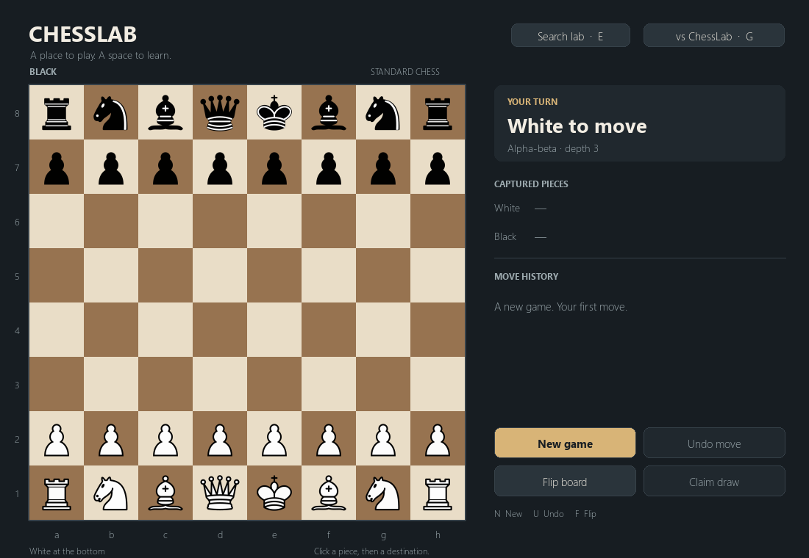

# ChessLab

ChessLab is a desktop chess game and a project for learning search algorithms. The Python/Pygame application supports local two-player games and a custom standalone C++17 opponent. Phases 2 and 3 are combined: Minimax and switchable alpha-beta pruning are implemented together with a comparison interface.



## Install and play on Windows

Install **Python 3.11 or newer** with Python on PATH. The verified environment is Windows with Python 3.11.8 and Pygame 2.6.1. Open PowerShell in this folder and run:

```powershell
.\setup.bat
.\launch.bat
```

Setup creates `.venv` and installs the pinned dependencies. It requires internet access on the first installation. The game uses bundled assets and needs no network connection. You can also double-click `launch.bat` after setup.

For manual installation or development:

```powershell
python -m venv .venv
.\.venv\Scripts\python.exe -m pip install -r requirements.txt
.\.venv\Scripts\python.exe -m app.main
```

The launch script changes to its own folder, so it works regardless of your current working directory. Direct module commands should run from the repository root. Missing assets or dependencies produce an error with setup instructions.

### Build and play against the engine

```powershell
.\build_engine.bat
.\launch.bat --mode engine
```

Build once after setup. The script installs a portable C++ compiler in `.venv` and produces `engine/build/chesslab-engine.exe`. No global toolchain installation is needed. The first compiler download is about 80 MB. Rebuild after changing C++ sources; generated binaries are not committed.

Press **G** or click the opponent button to choose local/engine play, your color, Minimax or alpha-beta, and depth 1–5. **Start new game** applies those choices. Press **E** for Search lab and **Compare position** to measure both algorithms on the same board without playing a move.

```powershell
.\launch.bat --mode engine --human-color black --algorithm minimax --depth 3
```

Local play remains the default. `--engine PATH` selects another build of ChessLab. Missing engines are reported in the interface; local play remains available.


### Linux

```bash
python3 -m venv .venv
.venv/bin/python -m pip install -r requirements.txt
.venv/bin/python tools/build_engine.py
.venv/bin/python -m app.main
```

The build needs recent C++17 GCC/Clang, or install `engine/requirements-build.txt` for the pinned compiler. Set `CXX` to override compiler selection. Linux desktop/build behavior is unverified. A graphical session is required for normal play.

## Controls

| Action | Mouse | Keyboard |
| --- | --- | --- |
| Move | Click your piece, then a legal destination | — |
| Change selection | Click another friendly piece | — |
| Deselect/cancel dialog | Click outside the board / dialog's Cancel | Escape |
| New game | New game | N |
| Undo one move | Undo move | U |
| Reverse orientation | Flip board | F |
| Claim an eligible draw | Claim draw | D |
| Choose promotion | Click Queen, Rook, Bishop, or Knight | Q, R, B, N in the promotion dialog |
| Scroll move history | Mouse wheel over the history | — |
| Choose opponent, color, algorithm, depth | Opponent button at top right | G |
| View statistics / compare algorithms | Search lab | E |

White starts at the bottom in local play; engine games initially face your color. New Game resets the position/history and keeps opponent settings. Local Undo removes one half-move. Engine Undo cancels pending work and returns to your previous decision, removing the reply and your last move when needed. The engine's opening move alone cannot be undone. Withdrawing a human draw claim leaves the board unchanged; undoing an engine claim also returns to your decision.

## Implemented features

- Resizable dark slate interface, ivory/walnut board, rank/file labels, and licensed local chess-piece artwork.
- Piece selection, legal destination dots, capture rings, previous-move highlights, and a checked-king indicator.
- Legal standard chess moves, captures, both castling sides, en passant, and all four promotion choices.
- Current turn, captured pieces grouped by capturing player, scrolling SAN move history, and clear results identifying the winner or draw reason.
- Checkmate, stalemate, insufficient material, automatic fivefold repetition, and the seventy-five-move rule.
- Explicit threefold repetition and fifty-move claims. The claim dialog lists eligible current-position claims or intended moves; scroll for additional choices. An intended-move claim declares the move without playing it.
- Reversible game endings, Undo, restart, manual board flipping, and keyboard shortcuts.
- Human vs Engine as either color, selectable Minimax/alpha-beta, and depth-limited search.
- Search lab compares depth, nodes, time, score, and selected move on one unchanged position. Partial timed-out results are labeled.
- Background UCI work, cancellation, stale-result rejection, and engine error reporting.

## Architecture

```text
app/
  main.py             CLI, startup errors, and shutdown
  application.py      Pygame event loop and layout
  game.py             Validated moves, history, captures, outcomes, draw claims
  input_handler.py    Selection and pending promotion
  engine_client.py    Background UCI jobs, cancellation, and statistics
  board_renderer.py   Orientation mapping, board drawing, cached piece images
  ui/                 Shared style, sidebar, promotion and claim dialogs
  assets/             PNG pieces, original SVGs, and license/attribution
tests/                Rules, interaction, event-loop, and rendering tests
tools/prepare_assets.py  Development-only artwork conversion
engine/src/           Standalone C++ UCI protocol and shared search
engine/vendor/        Pinned MIT-licensed rules library
tools/build_engine.py C++17 build helper
```

`Game` has no Pygame dependency. It validates a move before changing the board and records SAN and the actual captured piece before pushing. This also handles en passant and captures of promoted pieces correctly. Undo uses the original board stack, preserving castling, en passant, and repetition history.

`InputHandler` keeps temporary selection and promotion separate from committed moves. Rendering reads the game state. Board coordinates and hit testing share one orientation transform. Expensive draw eligibility checks are cached after state changes; fonts and piece images are cached, and the event loop runs at up to 60 FPS.

The engine independently represents positions and generates moves with a pinned C++ rules library. Our shared Minimax function evaluates material and optionally applies alpha-beta cutoffs. A Python worker sends full-history snapshots over UCI; only the GUI thread applies legal replies matching the current request and game revision.

## Tests and verification

```powershell
.\.venv\Scripts\python.exe -m pip install -r requirements-dev.txt
.\build_engine.bat
.\.venv\Scripts\python.exe -m pytest -q
.\.venv\Scripts\python.exe -m pip check
.\launch.bat --smoke-test 3 --screenshot chesslab.png
```

**Verified on Windows: 125 automated tests pass.** Build the engine before running the full suite. Tests cover rules, special moves, outcomes, draw claims, undo/reset, and a seeded 180-half-move game rewound position by position.

Engine checks include perft, legal moves cross-checked against python-chess, mate/score handling, Minimax/alpha-beta equivalence, UCI interruption, process errors, stale replies, and actual engine-to-GUI play/comparison. At initial depth 3, Minimax visits 9,323 nodes and alpha-beta 586: **93.7% fewer nodes**, with identical move and score.

Headless Pygame tests exercise mouse/keyboard events, modal dialogs, scrolling, resize, both orientations, artwork dimensions, missing-asset errors, and event-loop shutdown. Tests set SDL's dummy video driver so they do not open desktop windows. Screenshots of the initial board, promotion, checkmate, and draw dialog were visually inspected.

Windows setup/build, launch smoke testing, and dependency checks passed. A native desktop walkthrough exercised a human move, automatic C++ reply, same-position comparison, and Undo. Setup and diagnostics panels were also inspected at the minimum window size.

Read [AGENTS.md](AGENTS.md) for contributor instructions.

## Assets and dependencies

The Cburnett chess pieces and PNG conversions use CC BY-SA 3.0. All twelve individual source pages were checked for that license offer. See [asset attribution](app/assets/ATTRIBUTION.md) and the bundled full license. Runtime loads only the checked-in PNGs.

Rebuild the PNGs from local SVGs, without downloads:

```powershell
.\.venv\Scripts\python.exe tools\prepare_assets.py --offline
```

Running that tool without `--offline` checks the source licenses online and downloads missing originals. Third-party library notices are in [THIRD_PARTY_NOTICES.md](THIRD_PARTY_NOTICES.md).

## Current limitations

- Material-only evaluation makes many quiet moves tie; playing strength is deliberately basic. No positional evaluation or advanced search is implemented.
- GUI depth is 1–5 plies, with a 15-second safety limit per algorithm. Interrupted searches return a provisional move without a proven full-depth score.
- The engine claims eligible draws on its turn, even when a win might exist. Search assumes currently claimable repetition/fifty-move draws are taken.
- No clocks, save/load, PGN export, or drag movement.
- Games are held in memory and are discarded when the application closes.
- The minimum supported layout is 960 × 680; text uses an available system font.
- Dead-position adjudication follows python-chess's insufficient-material detection. Unusual blocked positions that are dead for other reasons are not exhaustively detected.
- Linux desktop behavior and other Python versions have not been verified.

## Roadmap

1. **Implemented:** playable Python/Pygame local two-player application.
2. **Implemented together (Phases 2–3):** independent C++ UCI engine, material evaluation, Minimax, switchable alpha-beta, Human vs Engine, and search comparisons.
4. Introduce iterative deepening, move ordering, transposition tables, quiescence search, and Principal Variation Search individually.
5. Explore advanced pruning and evaluation only after the fundamentals are reliable.
6. Add engine matches and performance/strength benchmarks.

Later phases require an explicit request. The engine performs its own search and evaluation without delegating them to another engine.

## Engine details

See [engine/README.md](engine/README.md) for evaluation values, shared search behavior, UCI commands, build options, node definitions, cancellation, rules-library attribution, and standalone diagnostics.
