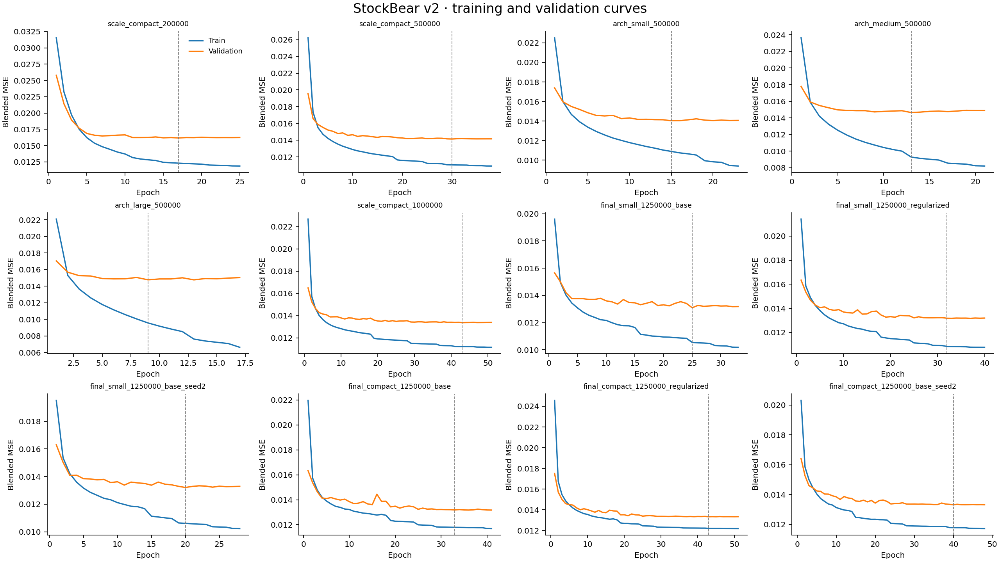
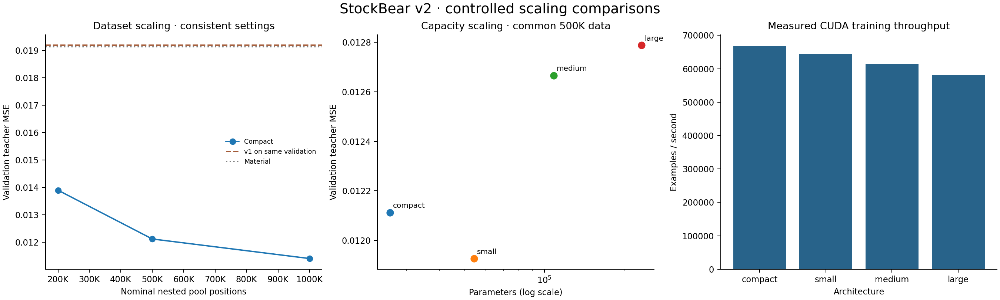
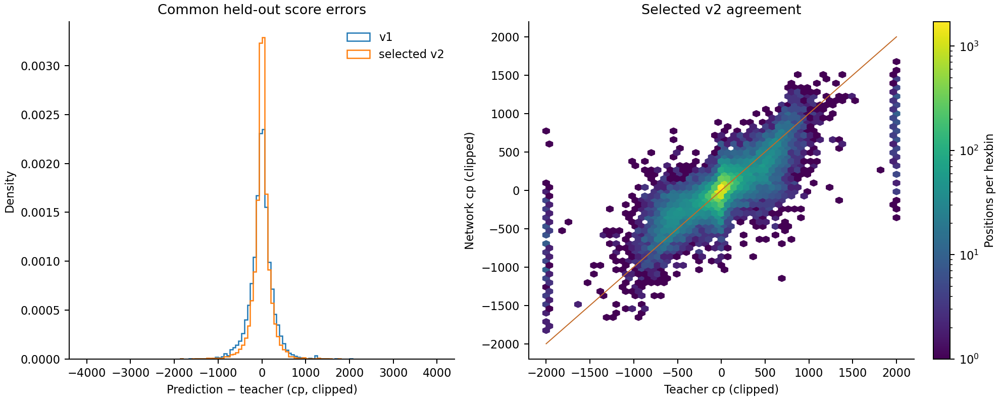

# StockBear NNUE v2 results

All requested execution phases completed. The selected primary-seed model is
**small**, trained on the **1,250,000-position
nested pool**. Selection used the mean validation blended MSE of two seeds;
test scores did not select models, widths, hyperparameters or epochs.

## Main findings

- Dataset scaling improved compact validation teacher MSE from
  0.013894 at 200,000 to 0.011399 at 1,000,000 nominal positions.
- At the common 500K budget, **small** had the lowest validation blended loss.
- The final selected v2 teacher MSE is **0.011128** on
  20,152 common held-out positions, compared with
  **0.019199 for v1** on those same positions (42.0% lower).
- Material baseline MSE on that cohort: **0.019193**.
- Selected model clipped cp MAE/RMSE: 143.53 /
  239.55; clipped-score Pearson correlation
  0.7748; decisive-position sign accuracy
  89.61%.
- Paired game-bootstrap 95% interval for v2 minus v1 test MSE: [-0.008490, -0.007614].
  Negative values favor v2. This measures supervised teacher agreement, not Elo.

The historical v1 MSE 0.016341 and cp MAE 197.79 came from a different, quieter
test distribution. They are historical references rather than direct v2
comparisons. The v1 figures above were remeasured on the common v2 holdout.

Small's two-seed mean validation blended loss was 0.75% lower than compact's. The primary checkpoints' test teacher MSEs were 0.011128 and 0.011022, respectively; cp MAEs were 143.53 and 143.93. The saved validation selection remains unchanged. The small differences support retaining both finalists rather than claiming a decisive architecture advantage.

## Validation ranking

Rows rank individual experiments by validation blended loss. Final architecture
selection instead uses the recorded two-seed means, avoiding a lucky-seed pick.

| Rank | Experiment | Pool size | Parameters | Epochs / selected | Val blended MSE | Val teacher MSE | Blended gap | Examples processed |
|---:|---|---:|---:|---:|---:|---:|---:|---:|
| 1 | final_small_1250000_base | 1,250,000 | 54,209 | 33 / 25 | 0.013093 | 0.011212 | 0.002740 | 32,982,312 |
| 2 | final_small_1250000_regularized | 1,250,000 | 54,209 | 40 / 32 | 0.013178 | 0.011297 | 0.002392 | 39,978,560 |
| 3 | final_compact_1250000_base | 1,250,000 | 26,081 | 41 / 33 | 0.013182 | 0.011230 | 0.001464 | 40,978,024 |
| 4 | final_small_1250000_base_seed2 | 1,250,000 | 54,209 | 28 / 20 | 0.013214 | 0.011296 | 0.002762 | 27,984,992 |
| 5 | final_compact_1250000_base_seed2 | 1,250,000 | 26,081 | 48 / 40 | 0.013325 | 0.011389 | 0.001579 | 47,974,272 |
| 6 | final_compact_1250000_regularized | 1,250,000 | 26,081 | 51 / 43 | 0.013331 | 0.011378 | 0.001146 | 50,972,664 |
| 7 | scale_compact_1000000 | 1,000,000 | 26,081 | 51 / 43 | 0.013368 | 0.011399 | 0.002203 | 40,778,121 |
| 8 | arch_small_500000 | 500,000 | 54,209 | 23 / 15 | 0.014034 | 0.011927 | 0.003602 | 9,195,009 |
| 9 | scale_compact_500000 | 500,000 | 26,081 | 38 / 30 | 0.014153 | 0.012113 | 0.003175 | 15,191,754 |
| 10 | arch_medium_500000 | 500,000 | 108,353 | 21 / 13 | 0.014648 | 0.012666 | 0.005806 | 8,395,443 |
| 11 | arch_large_500000 | 500,000 | 233,089 | 17 / 9 | 0.014771 | 0.012787 | 0.005975 | 6,796,311 |
| 12 | scale_compact_200000 | 200,000 | 26,081 | 25 / 17 | 0.016177 | 0.013894 | 0.004063 | 3,997,950 |

## Final selected candidates

| Architecture | Two-seed mean val blended MSE | Test teacher MSE | Test cp MAE | Clipped correlation | Export bytes |
|---|---:|---:|---:|---:|---:|
| small | 0.013153 | 0.011128 | 143.53 | 0.7748 | 218,029 |
| compact | 0.013253 | 0.011022 | 143.93 | 0.7739 | 105,518 |

## Data and leakage controls

The inventory contains 67 PGN/zstd archives, totaling
739,707,145 compressed bytes and 1,256,001
game records. Standard Zstandard skippable-frame prefixes are supported. PGN
metadata includes broadcast URLs, players, ratings, rounds and sometimes embedded
evaluations. Embedded evaluations were not treated as engine targets. Retained
games are completed standard broadcast games; invalid/nonstandard records
are omitted. Source metadata may include human and engine-like events; the separate
`source_metadata_audit.json` records all-header content hints, variants and rating
coverage without treating those hints as verified labels. Some source PGNs contained illegal SAN; retained sampled positions
were independently checked for legality before labeling.

The common pool contains 1,484,808 unique positions from
121,352 game groups. 4,248 aliases with identical
complete mainlines were merged. Group IDs and exact normalized FEN hashes prevent
game or exact-position overlap. v1 training positions are excluded from v2
holdouts, and known v1 game partitions are anchored. Header aliases with different
truncated move sequences can still evade alias detection; no claim is made that
every near-duplicate chess position is eliminated.

The deterministic nested order interleaves within-stratum quantiles by source
year, material/ply phase, heuristic tactical category and split. This preserves
approximately proportional diversity across prefixes rather than drawing
unrelated 200K/500K/1M datasets. Training uses the train partition of each prefix.
All controlled experiments use the same validation/test cohort drawn from the
first 200K prefix; extra held-out positions in larger prefixes remain reserved
and never become training positions. Manifests record nominal versus actually
used train/validation/test counts.

Checks, captures, promotions and material imbalances are retained. Passed-pawn,
advanced-pawn, king-pressure and unusual-configuration tags are heuristic
descriptors, not verified tactical truth. Diversity counts and all source hashes
are in `pool_report.json` and `inventory.json`.

## Teacher quality and resource use

The unchanged Stockfish 19 binary uses 16384 nodes, one thread per worker, 64 MiB
hash and normalized counters. A new-game reset calls the same Stockfish
`search_clear` as Clear Hash. Removing the redundant second reset matched all
64 cached v1 comparisons exactly, including score, mate distance, depth and nodes.
The separate v2 cache imports only compatible v1-profile labels and preserves
the original cache. Each batch and cursor commits safely; corrupt/illegal FENs
are rejected and retry failures retained.

The benchmark selected 6 workers at
153.1 positions/second.
Initial total label estimate was 2.27 hours;
the bounded job budget was 6 hours. Actual incremental
label times and rates are in `label_history.jsonl` and each size's report.
Higher-budget analysis compared 384 representative
positions at 65,536 nodes. Mean clipped score change was
31.20 cp; probability MSE between
budgets was 0.000416;
mate-status changes: 2. Phase, tactical,
magnitude and mate-proximity breakdowns are recorded. Higher budget is not
perfect ground truth, and the training target was not changed silently.

## Architecture, optimization and overfitting

All runs retain the v1 two-perspective 780-feature representation, shared sparse
feature sums, clipped ReLU, scalar side-to-move output and 400-cp score scale.
The target remains 90% sigmoid(clipped teacher cp/400) plus 10% game outcome.
No HalfKP, reinforcement learning, dropout, BatchNorm, quantization or SIMD was
introduced. Model widths/parameter counts and exported shapes are automatic.

Training used CUDA float32, fused AdamW, gradient clipping, validation LR
reduction, early stopping and best checkpoints. Feature arrays are prepared
once per prefix and reused across architectures; active indices fit in GPU
memory, avoiding repeated per-batch host conversion. AMP/TF32 were not enabled
without demonstrated need and parity. Per-run GPU allocation, epoch times,
throughput and examples processed are in `comparison.csv`. GPU memory numbers
include resident dataset tensors, not total driver/process VRAM. The Windows
monotonic timer can round very short pilot epochs to zero; full-run aggregate
throughput is reported and pilot timings are not ranked.

Stage A held compact settings fixed. Stage B used the same 500K dataset with
width-scaled learning rates. Stage C tested two recorded parameter settings for
the two leading architectures, then repeated their chosen setting with a second
seed. The search was bounded and recorded before final test evaluation.
Larger datasets also process more examples under an epoch cap; results are a
controlled practical scaling comparison, not a proof isolating data from every
optimization-budget effect. Generalization gaps and curves expose overfitting;
an exported model does not imply its gap has disappeared.

The common-data capacity results were:

| Architecture | Parameters | Train blended MSE | Val blended MSE | Val teacher MSE | Blended gap |
|---|---:|---:|---:|---:|---:|
| compact | 26,081 | 0.010978 | 0.014153 | 0.012113 | 0.003175 |
| small | 54,209 | 0.010432 | 0.014034 | 0.011927 | 0.003602 |
| medium | 108,353 | 0.008842 | 0.014648 | 0.012666 | 0.005806 |
| large | 233,089 | 0.008797 | 0.014771 | 0.012787 | 0.005975 |

The large model's gap was 0.005975, versus
0.003175 for compact. Its lower training error did
not translate to lower validation error. Under this bounded search, the data
supports the smaller finalists, not an automatic capacity increase.

## Size versus inference cost

The native source was inspected without modification. Its reader accepts width
up to 256 and hidden width up to 128, and it accepted every exported candidate.
Typical quiet-move accumulator work is about 4×width vector additions; dense-head
MACs are 2×width×hidden+hidden. Compact's dense head has
1,040 MACs; the 500K validation winner has
4,128. These are theoretical operation counts, not native
speed measurements. The selected primary model is 2.07× the compact
export's bytes and 3.97× its theoretical dense-head MACs. Accuracy
alone cannot establish whether that cost is worthwhile in search. Benchmark
the selected compact and small finalists next with paired openings, identical
search limits and measured latency; those native experiments remain future work.

No C++ engine, GUI, evaluator default or native weights were changed. No engine
matches or native inference-speed benchmarks were run. Subsequent playing tests
and inference optimization remain separate tasks.

## Exports, tests and reproducibility

All four architectures have independently named trained, validated exports in
`exports/v2/`. The leading two use their largest-data, selected primary-seed
checkpoints. Other architectures retain their validated 500K candidates.
`stockbear-v2-best.sbnnue` aliases the validation-selected winner. Golden FENs,
tensor shapes, padding zero row, checksum, feature/activation/score conventions,
NumPy/PyTorch parity and training-device parity were verified. The existing native
format parser was used read-only; no header generation or integration occurred.

Automated relevant suite: 30 tests, 0 failures,
0 errors and 0 skips. XML and logs are retained.
The pilot exercised label interruption/resume and CUDA epoch checkpoint recovery.
Original v1 exports and checkpoints are protected by hashes and verified intact.

Reproduce/resume from this project directory with:

```
.\.venv\Scripts\python.exe -m pytest
.\.venv\Scripts\python.exe -m stockbear.v2 run
```

The runner reuses completed datasets, labels and matching experiments and refuses
changed signatures or different candidate bytes. Source/configuration hashes,
teacher profiles, software/hardware audit, selection, manifests, epoch histories,
best/last checkpoints, comparisons and plots remain in the project. Large labeled
datasets are represented by shared pool/cache SQLite files plus nested-prefix
manifests and memory-mapped arrays rather than several redundant database copies.

## Plots and detailed evidence







`comparison.csv` includes each experiment's validation delta against v1 and the
material baseline. Each run's `metrics.json` contains phase, tactical/quiet and
year breakdowns. `selection.json` records the final choice before testing;
`V2_PROTOCOL.md` records the bounded execution plan.
