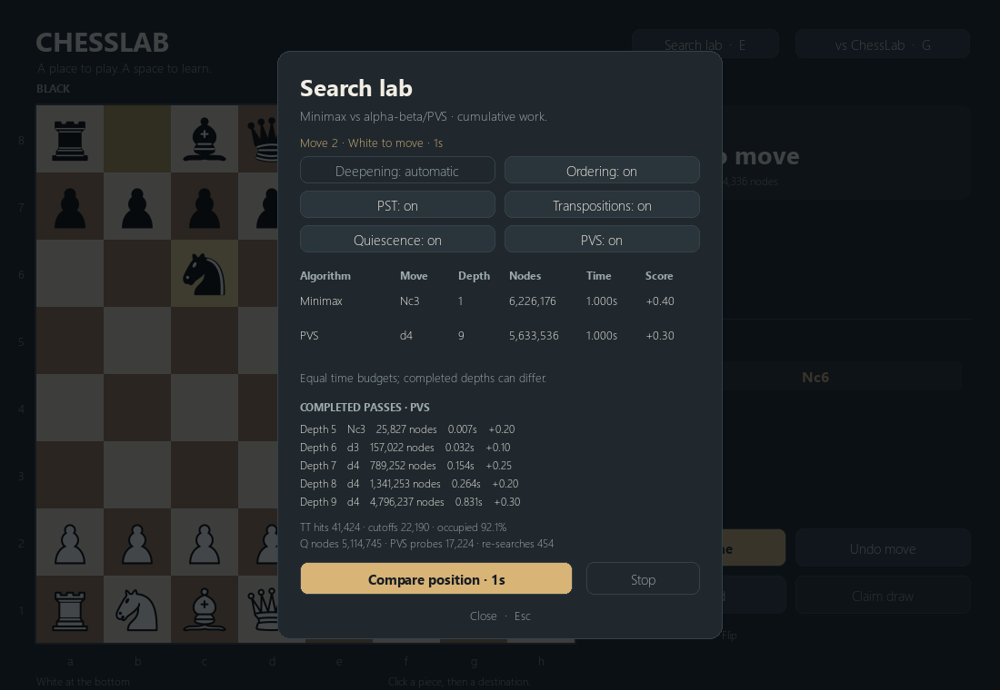

# Quiescence and Principal Variation Search

Gameplay now defaults to [time-controlled deepening](time-control.md). Fixed-depth
mode retains the comparisons below. Both features are enabled by default, independently switchable, and implemented
in the C++ engine. Quiescence changes what a search leaf means. PVS reduces work
while preserving full-window alpha-beta scores with NMP/LMR disabled at the same settings and completed
depth; equally scored moves can differ.

Current defaults also include [aspiration/NMP/LMR](search-optimizations.md).
The historical measurements below disable all three, and the reproduction tool
retains those conditions.

## Controls

- **G / game setup:** toggle **Quiescence** and **PVS**, then Apply to game to preserve the position, or Start new game.
  PVS is inactive when Minimax is selected; its preference is retained.
- **E / Search lab:** toggle either on the current position, then Compare position.
  Old rows clear, the board stays unchanged, and controls lock during searches.
  The comparison uses Minimax versus **PVS** or **Alpha-beta**, sharing Q settings.
- CLI: `--no-quiescence` and `--no-pvs` restore static leaves and full windows;
  `--quiescence` / `--pvs` explicitly enable them. Other settings are independent.

```powershell
.\launch.bat --mode engine
.\launch.bat --mode engine --no-pvs
.\launch.bat --mode engine --no-quiescence --no-pvs
```


## Quiescence behavior and limits

At nominal depth zero, search checks mate, stalemate, and existing draw rules
before evaluating. Outside check it uses static evaluation as **stand pat**, then
searches captures (including en passant) and all four promotions, even quiet ones.
In check it has no stand pat and searches **every legal evasion**, including quiet
king moves and blocks. Existing capture/promotion ordering applies. Minimax
exhausts the same tactical model; alpha-beta applies bounds throughout it.

The soft limit is **16 extra plies**. At that limit, or absolute ply **64**, a
non-check node returns static evaluation, even with captures remaining, and
increments `qcaps`. Checked nodes extend past the soft limit. A nonterminal check
at absolute ply 64 interrupts the pass (`plylimit=1`) instead of inventing a safe
static score. The last completed iteration survives; without one the result is
an unscored legal fallback. Terminal positions are resolved before either ceiling.

Time, stop, and node limits cover main search, Q, scouts, re-searches, and all
iterations together. This finite tactical search reduces horizon mistakes but
does not guarantee a quiet or correct final evaluation. Stand pat can miss
zugzwang. Quiet checking moves, SEE, delta pruning, and other new pruning methods
are not implemented. Dense tactical positions can cost substantially more work.

## Principal Variation Search

The first child gets a full window. Later children get a unit-width scout:
White uses `[alpha, alpha+1]`, Black uses `[beta-1, beta]`. A score strictly inside
the full window triggers a full re-search before updating the principal variation.
Fail-low/high results retain their bound meaning. Already-unit-width calls use
ordinary alpha-beta. Minimax always uses full windows and reports zero scouts.

Transposition entries retain exact/lower/upper bounds and normalized mate scores.
Only completed nodes are stored. Q nodes are not stored as ordinary main-depth
entries; main entries include their completed Q score/PV. When Q is enabled,
cache score reuse additionally requires matching root ply so the absolute safety
allowance agrees. Each search gets a fresh table, preventing mode contamination.

## Statistics and protocol

Nominal `depth` remains the requested main-search depth; `seldepth` includes Q
extensions and legal cached PVs. PVs may extend beyond nominal depth. Total
`nodes` includes Q nodes and repeated PVS work; the first Q leaf is counted once.
`qnodes` is a subset of nodes. Completed-pass snapshots keep move/score/PV
separate from final counters that include interrupted work.

```text
setoption name Quiescence value true
setoption name PVS value true
setoption name AlphaBeta value true
position startpos
go depth 3
```

Both UCI options are check options with default true. Search emits cumulative
`info string search qnodes N scouts N researches N qcaps N plylimit 0` and includes
those counters in its final summary. Search lab displays Q nodes, PVS probes,
and re-searches alongside TT statistics; stopped depths remain explicit.



## Verification

**773 tests pass on Windows.** An independent Python tactical oracle checks
White/Black recaptures, unsafe captures, quiet evasions, en passant, promotions,
and draws. Native tests isolate depth-zero Q and exercise stand pat, terminal
precedence, no partial PV publication, scouts, and re-searches. Integration tests
compare full-window/PVS scores across Q on/off, PST on/off, TT on/off, and
iterative/direct search; every reported PV is replayed legally. Tests also cover
Q caps, shared node budgets, responsive UCI stop/readiness, and GUI/client toggles.

Desktop verification includes e4 followed by a legal engine reply, setup's inactive
PVS state for Minimax, and Search lab comparisons with switches on/off without
changing the board. Headless renders cover normal/minimum window sizes and a
five-pass layout fixture; documentation images show actual engine results.

## Measurements

```powershell
.\.venv\Scripts\python.exe -m tools.benchmark_search --output artifacts\search-benchmark.json
```

The [recorded JSON](search-benchmark.json) includes all four Q/PVS modes, complete
FENs and PVs, SHA-256, CPU/OS, TT/Q/PVS counters, engine/NPS/wall timing, and three
samples per mode. Alpha-beta, PST, ordering, iterative deepening, and TT are on;
Hash=16 MiB cap, 15 seconds per search. Initial/Kiwipete/pawn ending use depth 4;
the horizon example uses depth 1. Rows select the median wall-time sample.

| Position | Q | Full-window nodes | PVS nodes | Move / White cp (both) |
| --- | --- | ---: | ---: | --- |
| Initial, depth 4 | Off | 3,599 | 3,282 | Nc3 / 0 |
| Initial, depth 4 | On | 3,743 | 3,567 | Nc3 / 0 |
| Kiwipete, depth 4 | Off | 9,362 | 8,634 | Bxa6 / +50 |
| Kiwipete, depth 4 | On | 141,975 | 82,297 | Bxa6 / +45 |
| Pawn ending, depth 4 | On | 556 | 559 | Ke5 / +55 |
| Poisoned pawn, depth 1 | Off | 21 | 21 | Qxa4 / +800 |
| Poisoned pawn, depth 1 | On | 32 | 38 | Qb2+ / +777 |

Q rejects the immediate queen-losing Qxa4 and finds a forcing safe continuation.
These scores include PST. PVS saves **42.0%** on quiescent Kiwipete and **4.7%**
on the quiescent opening, but increases work in the small ending/horizon examples.
Quiescence itself greatly expands Kiwipete; its finite caps are reached there.
Millisecond timings and NPS are noisy for small trees. These are work measurements,
not an Elo claim. Earlier PST/TT benchmarks explicitly disable Q/PVS to preserve
their historical baselines.

The algorithm references are Chess Programming Wiki's
[Quiescence Search](https://chessprogramming.org/Quiescence_Search) and
[Principal Variation Search](https://chessprogramming.org/Principal_Variation_Search).
The implementation is original repository code.
