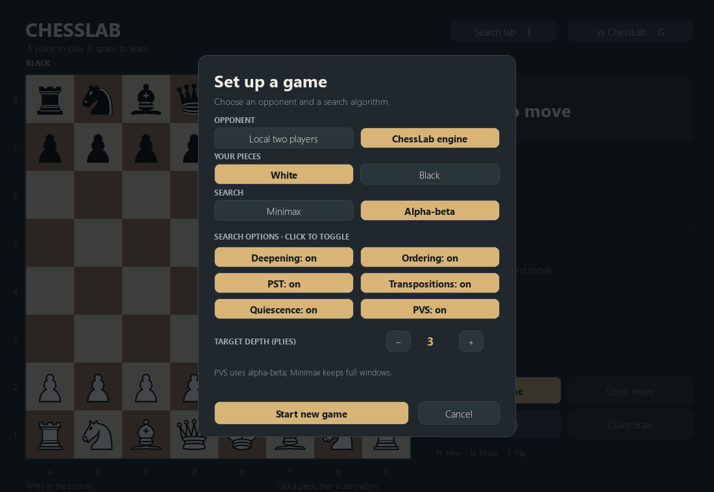

# Time-controlled iterative deepening

Gameplay defaults to **Standard (1 second)**. The C++ engine searches progressively
deeper within a per-request budget; depth 5 is no longer a gameplay limit. All
existing evaluators, search algorithms, ordering, TT, Q, and PVS are reused.
No additional pruning algorithms were added.

## Choose a budget

Press **G** or the opponent button. Under **Engine Thinking Time**, select one of
exactly five presets, keep **Time budget** selected, and click **Apply to game**.
The board, move history, and orientation remain unchanged. **Start new game**
applies settings and resets the position. Settings may be edited while thinking:
an active request retains its immutable settings; changes affect subsequent
requests. Changing opponent or human color cancels incompatible work.

| Preset | Budget |
| --- | ---: |
| Blitz | 100 ms |
| Fast | 500 ms |
| Standard (default) | 1 second |
| Deep | 3 seconds |
| Maximum | 5 seconds |



The board shows **StockBear is thinking...**, the last completed depth, elapsed
request time, and nodes from the latest checkpoint. Completed-move statistics show
final engine time and total nodes, including unfinished work. The GUI runs its
normal event loop; UCI communication stays on its existing Python worker.

## Time versus depth

```powershell
.\launch.bat --mode engine --thinking-time 1000
.\launch.bat --mode engine --thinking-time 5000
.\launch.bat --mode engine --search-mode depth --depth 5
.\launch.bat --mode engine --search-mode depth --depth 3 --no-iterative-deepening
```

`go movetime 1000` sends **no depth limit**: it forces iterative deepening even
when the UCI IterativeDeepening preference is false. The safe main/absolute ply
ceiling remains 64. Terminal positions and proven root mates may finish early.
`go depth 5` keeps the reproducible nominal depth and selected iterative/direct
policy. Combining depth and movetime obeys both limits and keeps that policy.
UCI explicit depths remain 1–8; GUI fixed-depth debugging remains 1–5 with a
15-second watchdog. GUI time mode has no low depth cap.

Search lab compares the same position with the same time budget for each algorithm.
Completed depths and scores can differ; it does not present node reduction as a
same-depth comparison. Select Fixed depth in setup for that comparison. Timed mode
shows **Deepening: automatic**. The other feature switches retain their meanings.

## Deadline and safe interruption

`Search` records a `std::chrono::steady_clock` start and deadline before table
allocation. Main search and Q check the atomic stop flag and node budget every
invocation. Clock checks occur every **256 nodes** and before starting each pass,
covering PVS scouts and re-searches too. There is one engine worker per `go` and
one TT/PV context shared by its iterations; no process restarts occur between depths.

A deadline, external stop, or safety interruption throws through recursive calls.
`ScopedMove` restores every speculative board move with RAII, including on exception
paths. Incomplete nodes never reach TT storage. Completed descendants stay valid,
but an incomplete root pass cannot overwrite the last completed move, score, or PV.
Without a completed pass the engine returns a legal unscored fallback; positions
with no legal move return UCI `0000`. The input loop signals and joins its one worker;
stop/quit produce one bestmove response and quit terminates cleanly.

Python requests carry full-history snapshots, immutable settings, position revisions,
and tokens. Progress updates never play moves. Undo, New Game, changed positions,
and shutdown cancel/discard old work; only a matching final response may play.
Cancellation schedules UCI stop without waiting on the GUI thread. The worker
then sends quit and closes the transport, avoiding races with analysis startup.
Opening setup does not cancel a move just to change its next budget.

## Measurements

The measurements below predate [aspiration/NMP/LMR](search-optimizations.md).
Their reproduction tool explicitly disables all three; current gameplay defaults
enable them. The optimization guide contains current staged timed measurements.


```powershell
.\.venv\Scripts\python.exe -m tools.benchmark_time --repeats 3 --output artifacts\time-benchmark.json
```

The [recorded JSON](time-benchmark.json) contains **105 runs**: seven positions,
five presets, three repeats. It records FENs, binary SHA-256, CPU/OS, requested
budget, engine and wall time, completed depths, legal PVs/moves, nodes, NPS,
and TT/Q/PVS counters. Alpha-beta, PVS, Q, PST, ordering, iterative deepening,
and TT are on, with Hash=16 MiB. Each displayed row selects median wall time.

Opening results (initial position):

| Preset | Requested ms | Engine ms | Wall ms | Completed depth | Total nodes | NPS | Best move |
| --- | ---: | ---: | ---: | ---: | ---: | ---: | --- |
| Blitz | 100 | 100 | 101.9 | 6 | 550,656 | 5,506,560 | Nc3 |
| Fast | 500 | 500 | 501.9 | 7 | 2,824,704 | 5,649,408 | e4 |
| Standard | 1000 | 1000 | 1002.0 | 8 | 5,514,496 | 5,514,496 | e4 |
| Deep | 3000 | 3000 | 3001.8 | 8 | 16,389,888 | 5,463,296 | e4 |
| Maximum | 5000 | 5000 | 5002.0 | 8 | 27,563,520 | 5,512,704 | e4 |

Completed depths across the four nonterminal positions:

| Position | 100 ms | 500 ms | 1 second | 3 seconds | 5 seconds |
| --- | ---: | ---: | ---: | ---: | ---: |
| opening | 6 | 7 | 8 | 8 | 8 |
| middlegame | 5 | 6 | 7 | 7 | 7 |
| tactical | 5 | 6 | 7 | 8 | 8 |
| endgame | 11 | 13 | 13 | 14 | 15 |

All returned moves and PVs replay legally. Returned move/score/depth match the last
completed checkpoint. The checkmate and stalemate positions return null moves at
depth 1 in roughly 3 ms wall time; a mate-in-one returns Qg7# at depth 1, also
roughly 3 ms, rather than consuming its full budget. Individual samples can finish
different depths near a checkpoint; the JSON preserves all three runs.

These measurements show that timed search exceeds depth 5 and respects budgets
with small observed overhead. They do not promise exact millisecond precision:
OS scheduling, initial TT allocation, communication, process startup, and GUI frame
scheduling add latency. The benchmark reuses one initialized UCI process across
requests; the GUI currently starts a worker/process per request, adding startup
latency outside the engine's measured budget. Deadline overshoot is bounded by
check frequency and scheduler delays, not a real-time guarantee.

Longer thinking generally helps playing strength but does not guarantee a better
move or greater completed depth on every run. Minimax can spend most of its budget
on one Q-heavy iteration. Q retains its documented 16/64-ply safety boundaries;
an absolute check ceiling can interrupt before the requested time. Draw claims
retain existing semantics; no chess clocks, time allocation, or new heuristics
were introduced.

## Verification

**773 tests pass on Windows.** Tests cover time-mode defaults/presets, actual client
budgets, timed depth above 5, forced deepening, terminal/forced-mate early returns,
matching completed snapshots, special/nested board restoration on exception,
legal fallback before depth 1, responsive UCI readiness/stop/quit with exactly one
bestmove, no overlapping go workers, and fresh fixed-depth results after cancellation.
GUI tests cover applying all five budgets during a request without resetting it,
local play, discarded drafts, progress without move application, Undo/New Game,
flipping, resize, shutdown, and stale-reply rejection. Fixed-depth baseline tests
remain explicit and pass unchanged search expectations.

Windows desktop checks and real-engine headless event-loop checks verify preset
selection, actual play above depth 5, applying settings without changing the
position, and cancellation. Setup and Search lab renders are inspected at
1100×760 and the minimum 960×680, including five-pass history.
