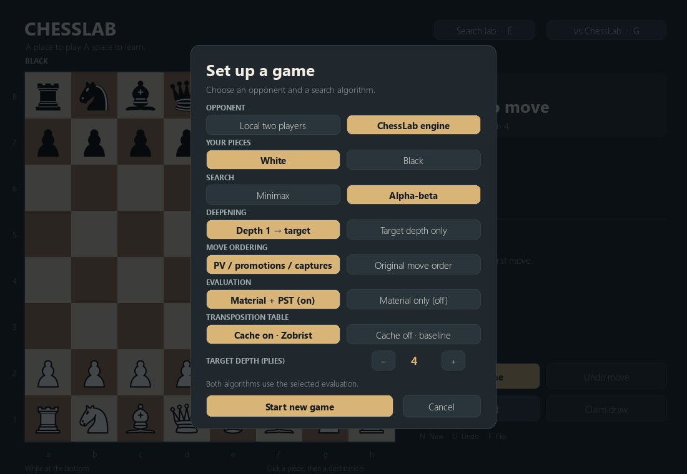

# Transposition tables and Zobrist hashing

The rules library already maintained an incremental 64-bit Zobrist position key
for repetition detection. ChessLab now reuses it to cache completed search nodes.
The vendored header is unchanged; [transposition.hpp](../engine/src/transposition.hpp)
and [search.cpp](../engine/src/search.cpp) implement the cache and its integration.

## Keys and draw context

`Board::hash()` covers colored piece locations, side to move, castling rights,
and legal en-passant availability. `makeMove<true>` updates it incrementally;
unmake restores it. Native tests compare it with full `Board::zobrist()` recomputation
through captures, en passant, both castling sides, and promotions.

A position key alone cannot distinguish fifty-move clocks or repetition histories.
Each entry also verifies the halfmove clock and a 64-bit fingerprint of known
prior positions since the last pawn move/capture. That fingerprint sums mixed
Zobrist keys: order does not matter, but repeated occurrences do. Pawn moves and
captures reset it. UCI position parsing tracks pre-root history; recursion extends
it without board copies or history-vector allocations. Direct C++ callers must
maintain `SearchLimits.history` using `next_history()` when supplying a board with
pre-root move history. A FEN alone supplies no unknown earlier repetitions.

Different reversible histories are deliberately kept separate, even when neither
currently repeats. A future search line could revisit a historical position.
This conservative policy sacrifices some cache hits to preserve draw semantics.
Mate, stalemate, and existing draw checks happen before probing the cache.

## Entries, bounds, and principal variations

Each entry stores the full position key, history fingerprint, halfmove clock,
remaining depth, White-relative score, bound type, and a compact PV of up to 64
encoded legal moves. Index collisions require a full key/context match; mismatches
are misses. Deeper entries receive replacement priority; at equal depth, an exact
entry is preserved over a weaker bound for the same position/context.

For an equal-depth hit:

- Exact scores can return immediately in either algorithm.
- Lower bounds can cut off alpha-beta only when the score is at least beta.
- Upper bounds can cut off alpha-beta only when the score is at most alpha.
- Minimax never returns a bound as an exact value.

Different-depth entries supply ordering hints only. Requiring equal depth for
score reuse keeps fixed-horizon comparisons with the uncached baseline meaningful.
A deeper score is not automatically the same answer as a shallower search.

Mate scores are converted from root-relative ply distance to position-relative
distance on storage, then converted back at the probing ply. Full compact PVs
preserve completed lines without depending on other slots surviving replacement.
The first cached move is checked against generated legal moves before reuse.
When ordering is enabled, a matching table move precedes the previous completed
PV move, promotions, captures, and quiet moves. Disabling ordering disables that
hint while retaining valid score reuse.

Only completed nodes are stored; an interruption unwinds before storing an
unfinished node. Completed descendants remain valid. The root still publishes
only completed iterations, preserving its saved move, score, and PV together.

## Lifetime and memory

The table is fresh for every `go`, shared across that search's iterative passes,
and freed when the worker finishes. No scores survive evaluation-mode changes,
algorithm comparisons, position changes, or new games. There is no persistent
cache or separate Clear Hash operation in this milestone.

UCI `Hash` defaults to a **16 MiB upper bound**, range 1–256 MiB. Slot count rounds
down to a power of two within that bound. Compact full PVs make entries larger
than conventional move-only tables. The table is allocated only when enabled;
uncached search skips all probes, stores, table hints, and history-fingerprint work.

## Controls and diagnostics

- Setup (**G**): **Cache on · Zobrist** / **Cache off · baseline**, then Start new game.
- Search lab (**E**): **Transpositions: on/off** preserves the position and clears
  old rows. Rerun Compare position; both algorithms use the selected setting.
- CLI: `--transposition-table` or `--no-transposition-table`; default is on.
- UCI: `setoption name TranspositionTable value false` disables caching.
  `setoption name Hash value 32` sets the next search's memory cap.



Standard `info` lines report `hashfull` as occupied slots per thousand. UCI-safe
`info string tt probes N hits H cutoffs C` lines report cumulative matching entries
and actual score returns; matching entries of other depths count as hits but not
cutoffs. Final summary includes totals from unfinished work. GUI rows display
hits, cutoffs, and occupancy for the latest algorithm. These are cache statistics,
not tablebase hits. Nodes still count every search invocation, including cache hits.

## Verification and measurements

```powershell
.\build_engine.bat
.\.venv\Scripts\python.exe -m pytest -q
.\.venv\Scripts\python.exe -m tools.benchmark_transpositions --depth 5 --repeats 3 --output artifacts\tt-benchmark.json
```

**375 tests pass on Windows.** Pytest compiles the native TT test executable with
the existing build helper; keep the C++ compiler available. Native tests cover
incremental/full hash agreement, make/unmake, castling/en-passant/side keys, empty
and colliding slots, context guards, replacement priority, all bound types, depth
checks, and mate-score normalization. Engine integration compares cached/uncached
scores and complete legal PVs across both algorithms, both evaluation modes,
direct/iterative search, special moves, pre-root repetitions, clock limits,
interruption, fresh-search isolation, and GUI controls. Chosen moves are also
checked through an independent uncached exhaustive child search.

Windows native verification covers setup on/off, real engine reply after e4,
and both Search lab modes without changing the position. Rendered panels were
inspected at 1100×760 and the minimum 960×680.

Recorded [raw results and all FENs](tt-benchmark.json) use the same machine,
alpha-beta, PST, iterative deepening, and ordering; depth 5, Hash=16, a 15-second
cap per search, three repeats with on/off order alternated. Each row below uses
the median wall-time sample. All pairs return identical moves and White scores.

| Position | Move / White cp | Nodes off | Nodes on | Reduction | Hits / cutoffs on | Engine seconds off / on |
| --- | --- | ---: | ---: | ---: | --- | --- |
| Initial | e4 / +70 | 182,596 | 118,406 | 35.2% | 2,499 / 1,672 | 0.020 / 0.017 |
| Kiwipete | dxe6 / +315 | 87,554 | 62,262 | 28.9% | 3,166 / 823 | 0.014 / 0.013 |
| Pawn ending | Ke5 / +65 | 2,056 | 1,929 | 6.2% | 190 / 4 | 0.000 / 0.002 |

Raw JSON also records NPS, high-resolution wall time, occupancy, engine hash, CPU,
OS, and every sample. Engine time has millisecond resolution; sub-millisecond
measurements and NPS are noisy. Fresh table allocation can make small searches
slower despite fewer nodes, as in this endgame. Savings are position-dependent
and establish no playing-strength or Elo claim.

Cross-search persistence, more aggressive history handling, quiescence, PVS, and
other search heuristics remain future work requiring a new request.
